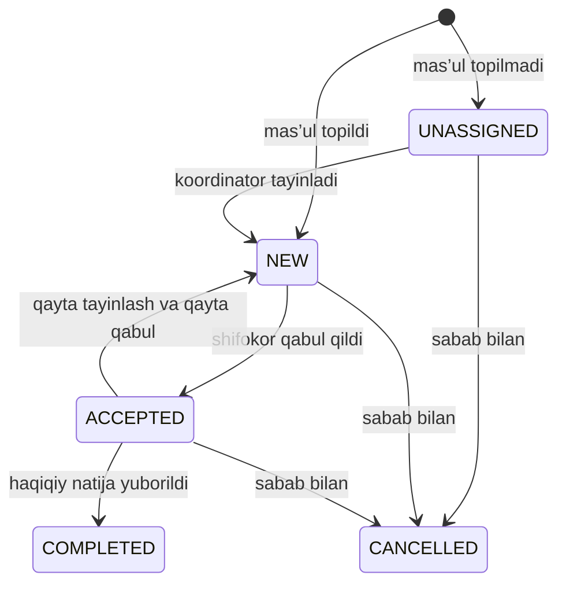
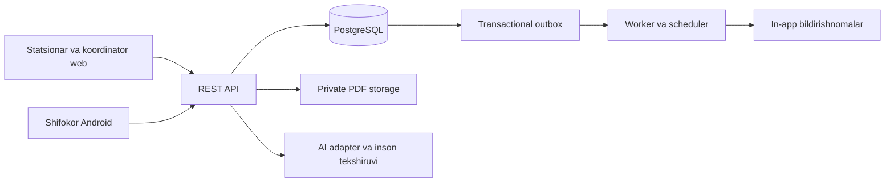

# MedicineTrack — texnik topshiriq

Versiya: 1.3 • Sana: 2026-11-18 • Holat: ishlab chiqish uchun bazaviy loyiha.

## 1. Hujjat asosi va chegaralari

Manba: `toshkent_dolzarb_muammolar (1).pdf`, 1-bet, 11-muammo, Umummilliy AI Xakaton (17–19 noyabr 2026).

**Manbadagi talab:** og‘ir bemor statsionardan (OvaBMU) chiqarilganda hududiy oilaviy shifokorga avtomatik “Aktiv chaqiruv” topshirig‘i yuboriladi; shifokor 24 soat ichida bemor holidan xabar olib, tizimda tasdiqlaydi.

Ushbu TZdagi arxitektura, AI, eslatmalar, rollar va sinov mezonlari jamoa uchun taklif etilgan yechimdir. 24 soat — topshiriq talabi; huquqiy norma sifatida ko‘rsatilmaydi. OvaBMU atamasi manbadagidek saqlandi; to‘liq rasmiy nomi PM tomonidan aniqlanadi. Reponing boshlang‘ich holatida faqat README va .gitignore mavjud: quyidagi imkoniyatlar hali implementatsiya qilingan deb hisoblanmaydi.

## 2. Maqsad va foydalanuvchi qiymati

MedicineTrack statsionar va oilaviy shifokor o‘rtasidagi bemor topshirish jarayonini kuzatiladigan vazifaga aylantiradi. Har bir chiqarish uchun mas’ul, o‘zgarmas muddat, aloqa tarixi va bajarilganlik dalili bo‘ladi. Koordinator mas’ulsiz yoki kechikkan bemorlarni alohida ko‘radi.

MVP muvaffaqiyati: demo bemorini chiqarishdan shifokor tasdig‘igacha bo‘lgan jarayon web va Android orqali bir xil backendda ishlaydi; 24 soat nazorati va kirish cheklovlari sinovdan o‘tadi. Qayta yotqizish yoki o‘limni kamaytirish kabi klinik natijalar prototip bilan isbotlangan deb ko‘rsatilmaydi.

## 3. Jamoa va javobgarlik

| Yo‘nalish | Mas’ul | Topshiriladigan natija |
|---|---|---|
| PM | @robiya777 | Scope, backlog, klinik jarayon savollari, demo, qabul tekshiruvi |
| Frontend web | @nuraziz07 | Statsionar va koordinator kabineti, responsive UI, API integratsiyasi |
| Android / APK | @akashishunichiro (foydalanuvchi) | Shifokor ilovasi, chaqiruvlar, natijani yuborish, o‘rnatiladigan APK |
| Backend | @sunnatila | API, DB, autentifikatsiya, SLA, bildirishnoma, AI adapter, deploy |

Handlelar foydalanuvchi bergan yozilishda kiritildi; GitHub akkauntlari yoki repo ruxsatlari tasdiqlangani anglatilmaydi. Backend API kontraktini yuritadi, frontend va APK iste’molchi talablarini bildiradi, PM o‘zgarishlarni ustuvorlashtiradi. Klinika tomonidan vakolatli mutaxassis mahsulot jamoasidan alohida tayinlanishi kerak.

## 4. MVP va keyingi bosqich

### P0 — majburiy

- Rollar bilan kirish; muassasa va bemor darajasida ruxsat.
- Bemor va tasdiqlangan chiqarish yozuvi.
- Bitta chiqarishga bitta avtomatik chaqiruv; shifokorga deterministik biriktirish.
- Mas’ul topilmasa koordinator navbati va uzluksiz 24 soat hisoblagichi.
- Shifokorning qabul qilishi, aloqa urinishlari, bajarish natijasi.
- Muddatdan oldin eslatma va muddatdan keyin eskalatsiya.
- Web monitoring va Android shifokor oqimi.
- Audit, demo dataset, API hujjati, ishga tushirish yo‘riqnomasi.
- Bemor kabineti: mas’ul shifokorga matn yozish, holat yuborish va javobni ko‘rish (§23).
- Shifokor tasdiqlagan dori jadvali, Android lokal eslatmalari va bemor qayd etgan qabul tarixi (§24).

### P1 — xakatondagi AI moduli

Matnli PDF epikrizdan manbasi ko‘rsatilgan maydonlar va qisqa xulosa loyihasini ajratish, inson tasdig‘i bilan saqlash. P0 ishini bloklamaydi, lekin AI xakaton demosiga kiritiladi.

### Keyingi bosqich

Davlat tibbiy tizimlari, haqiqiy SMS/push provayderi, skan PDF uchun OCR, to‘liq offline sinxronizatsiya, elektron imzo va ko‘p tillilik. MVPda davlat bazalariga mavjud bo‘lmagan ulanish va’da qilinmaydi. Yangi dori tayinlash, avtomatik doza tanlash, tashxis qo‘yish va tez yordam dispetcherligi scopega kirmaydi. Mavjud shifokor ko‘rsatmasi asosidagi qabul jadvali va eslatmalar §24ga kiradi.

## 5. Rollar va kirish matritsasi

| Amal | Statsionar xodimi | Oilaviy shifokor | Koordinator | Texnik admin |
|---|---|---|---|---|
| Bemor/chiqarish loyihasini kiritish | O‘z muassasasida | Yo‘q | Yo‘q | Yo‘q |
| Chiqarishni tasdiqlash | Vakolatli xodim | Yo‘q | Yo‘q | Yo‘q |
| Bemor kartasini ko‘rish | O‘zi yaratgan chiqarish doirasida | Aktiv biriktirilgan vazifada | O‘z xizmat hududida | Standart holatda yo‘q |
| Qabul qilish va natija | Yo‘q | O‘z vazifasida | Yo‘q | Yo‘q |
| Qayta biriktirish/bekor qilish | Yo‘q | Yo‘q | O‘z hududida, sabab bilan | Yo‘q |
| Hisobot | O‘z chiqargan yozuvlari | O‘z vazifalari | O‘z hududi | Faqat texnik metrikalar |
| Akkaunt/ma’lumotnoma | Yo‘q | Yo‘q | Yo‘q | Ha |

UI yashirish yetarli emas: barcha tekshiruv backendda bajariladi. Topshiriq yopilgach shifokorda shu topshiriq tarixi qoladi; qayta biriktirilganda oldingi shifokor bemorning yangilanayotgan kartasini ko‘rmaydi. Texnik admin uchun klinik ma’lumotga alohida, audit qilinadigan ruxsat keyinchalik loyihalanadi.

## 6. Asosiy ssenariylar

### UC-01. Bemorni chiqarish

1. Statsionar xodimi bemorni mavjud ichki ID bo‘yicha tanlaydi yoki yaratadi.
2. Manzil, telefon, xizmat hududi, chiqarish vaqti va tavsiyalarni kiritadi.
3. Epikrizni biriktirishi va AI ajratgan maydonlarni tekshirishi mumkin.
4. Tasdiqlashdan oldin majburiy maydonlar va vaqt ko‘rsatiladi.
5. Bitta DB tranzaksiyada chiqarish tasdiqlanadi, chaqiruv va outbox hodisasi yaratiladi.
6. Xodim topshiriq IDsi, mas’ul va deadline’ni ko‘radi.

### UC-02. Biriktirish

Bemorning faol biriktirilishi → faol oilaviy shifokor va tegishli muassasa tekshiruvi → tayinlash. Topilmasa tizim tasodifiy shifokor tanlamaydi: `UNASSIGNED` navbatini yaratib koordinatorni ogohlantiradi. Koordinator faol shifokorni tanlaydi va sabab yozadi. Muddat o‘zgarmaydi.

### UC-03. Shifokor bajarishi

Shifokor APK yoki webda vazifani ochadi, qabul qiladi, bemor bilan bog‘lanadi/tashrif buyuradi. Aloqa urinishlarini qayd etadi. Majburiy natija formasi to‘ldirilgach server bajarishni tasdiqlaydi. “O‘qidim” yoki “Qabul qildim” bajarilganlik hisoblanmaydi.

### UC-04. Bemor bilan bog‘lanib bo‘lmasligi

Telefon javobsiz, noto‘g‘ri raqam, manzil topilmadi yoki rad etish alohida `ContactAttempt` bo‘ladi. Vazifa ochiq qoladi. Keyingi harakat va izoh kiritiladi; koordinatorga yordam so‘rovi yuborish mumkin. Bunday sabablar 24 soatni uzaytirmaydi.

### UC-05. Xato yozuv va qayta yotqizish

Tasdiqlanmagan loyiha tahrirlanadi. Tasdiqlangan chiqarish va natija jim o‘zgartirilmaydi: tuzatish sababi, eski/yangi qiymatlar auditda saqlanadi. Noto‘g‘ri chiqarishni koordinator sabab bilan bekor qiladi. Qayta yotqizish mavjud vazifani avtomatik “bajarildi” qilmaydi; koordinator uni tegishli sabab bilan bekor qiladi. Keyingi chiqarish alohida yangi hodisa va yangi chaqiruvdir.

### Vakolat va tahrir bo‘yicha aniqlashtirishlar

- Xodimning hududiy vakolati `User.organization_id → Organization.territory_id` orqali olinadi. Vazifa qabul qiluvchi tashkiloti bemorning xizmat hududiga biriktirilgan faol poliklinika orqali aniqlanadi. Tashkilot ham topilmasa `receiving_org_id=null` bo‘ladi va vazifa chiqaruvchi shifoxona koordinatorining istisnolar navbatida qoladi. Bu navbatga faqat shu shifoxona koordinatori kira oladi.
- Hududlararo transfer MVPga kirmaydi: vazifa chiqaruvchi koordinator nazoratida qoladi, PM vakolatli qabul qiluvchini aniqlaydi. MVP koordinatoriga boshqa hudud bemorlarini ko‘rish yoki o‘zicha boshqa hududga o‘tkazish huquqi berilmaydi.
- Mavjud bemorni qidirish faqat shu shifoxona ilgari yaratgan kartalar doirasida, aniq ichki UUID orqali amalga oshiriladi; global ism/telefon qidiruvi yo‘q. Topilmasa yangi karta yaratiladi; muassasalararo bemorlarni birlashtirish MVPdan tashqarida. Patientga `created_by_org_id` qo‘shiladi.
- Patient PATCH faqat yaratgan statsionar xodimiga va hali tasdiqlanmagan chiqarish doirasida kontakt/manzil kabi maydonlar uchun ruxsatli. Tasdiqlash paytida F.I.Sh., kontakt, manzil va klinik tavsiyalar discharge ichidagi snapshotga yoziladi; keyingi karta o‘zgarishi tarixiy taskni o‘zgartirmaydi. Shifokor aloqa tuzatishini ContactAttempt izohida bildiradi.
- Tasdiqlangan yozuvni tuzatish append-only: statsionar xodimi o‘z discharge tavsiyasiga, biriktirilgan shifokor o‘z VisitReport matniga correction qo‘shadi. Original o‘zgarmaydi. Discharged_at, performed_at, completed_at, due_at va task status correction bilan o‘zgarmaydi. Noto‘g‘ri chiqarish vaqti bo‘lsa koordinator bekor qiladi, statsionar bog‘langan yangi chiqarish yaratadi; bekor qilish alohida hisobotda qoladi.

## 7. Holatlar va vaqt qoidalari

- `overdue` mustaqil flag: ochiq vazifada `server_now > due_at`; alohida workflow holati emas.
- `due_at = discharged_at + 24 soat`. `discharged_at` — statsionardan haqiqiy chiqarilgan vaqt, `confirmed_at` — tizim tasdig‘i vaqti; ular alohida saqlanadi.
- Kelajakdagi chiqarish vaqtini tasdiqlash mumkin emas. Kech kiritilgan chiqarish uchun dastlabki muddat saqlanadi; muddat allaqachon o‘tgan bo‘lsa darhol eskalatsiya qilinadi.
- Vaqt UTCda saqlanadi, UI `Asia/Tashkent`da ko‘rsatadi. Dam olish kuni muddatni to‘xtatmaydi.
- Eslatmalar: chiqarilgandan 12 va 20 soat keyin, vazifa hali ochiq bo‘lsa. O‘tib ketgan eslatmalar kech importda birdaniga yuborilmaydi; faqat dolzarb ogohlantirish yuboriladi.
- 24 soat o‘tganda koordinatorga bitta eskalatsiya hodisasi yaratiladi; dashboard kechikishni davomiy ko‘rsatadi.
- Qayta tayinlash faqat ochiq task uchun: yangi shifokor tanlanganda status NEW, accepted_at=null; avvalgi qabul hodisasi auditda qoladi. Yangi shifokor qayta qabul qilishi shart. Terminal task qayta tayinlanmaydi.
- Qayta tayinlash, servis restarti, bildirishnoma xatosi muddatni yangilamaydi.
- Tashrif vaqti `discharged_at <= performed_at <= server_now`; yakunlash uchun `ACCEPTED` talab qilinadi.
- O‘z vaqtida bajarilganlik serverdagi `completed_at <= due_at` bo‘yicha hisoblanadi. Kech kiritilgan, lekin oldin bajarilgan tashrif alohida “kech hujjatlashtirilgan” sifatida ko‘rsatiladi; asosiy KPI orqaga sana yozish bilan yaxshilanmaydi.
- Yopilgan vazifa qayta ochilmaydi; tuzatish audit yozuvi bilan amalga oshiriladi.

## 8. Maydonlar va validatsiya

| Obyekt | Majburiy maydonlar | Qoidalar |
|---|---|---|
| Bemor | UUID, F.I.Sh., tug‘ilgan sana, manzil, hudud | Tug‘ilgan sana kelajakda emas; JSHSHIR MVPda talab qilinmaydi |
| Aloqa | kamida bitta telefon yoki “telefon yo‘q” sababi | Telefon bo‘lsa E.164; vakil telefoni alohida belgilanadi |
| Chiqarish | bemor, muassasa, discharged_at, shifokor tavsiyasi, kuzatuvga kiritish asosi | Og‘ir bemor ekanini klinik xodim belgilaydi; AI aniqlamaydi |
| Epikriz | fayl, yuklovchi, vaqt | Ixtiyoriy; PDF ≤10 MB, MIME va fayl signaturasi tekshiriladi |
| Chaqiruv | discharge_id, status, due_at, version | discharge_id UNIQUE; assignee UNASSIGNEDda null |
| Aloqa urinishi | task_id, vaqt, kanal, natija, muallif | O‘z vazifasi; discharged_at ≤ attempted_at ≤ server_now; recorded_at serverda, kech qayd alohida |
| Bajarish | performed_at, kanal, kuzatuv, bajarilgan ish, keyingi reja | “Kuzatuv talab qilinmaydi” bo‘lsa ham asos yoziladi |
| Bekor qilish | sabab kodi, izoh, muallif, vaqt | Koordinator vakolati; o‘chirish emas |

MVPda telefon orqali aloqa ham, uyga tashrif ham demo uchun yakunlash kanali bo‘lishi mumkin; real pilotdan oldin klinik hamkor qaysi holatda qaysi kanal yetarliligini tasdiqlaydi. Bu qaror mahsulot sozlamasi orqali boshqarilishi kerak.

## 9. AI modulining aniq kontrakti

Kirish: faqat vakolatli foydalanuvchi yuklagan matnli PDF yoki epikriz matni. Skan yoki o‘qilmaydigan faylga “Matn topilmadi, qo‘lda kiriting” qaytariladi. Hujjat ichidagi buyruqlar ma’lumot hisoblanadi, tizim ko‘rsatmasi sifatida bajarilmaydi.

Chiqish JSON: `summary`, `diagnosis_text`, `recommendations[]`, `follow_up_text`, `evidence[]` (maydon, sahifa, manba parchasi), `missing_fields[]`, `warnings[]`. Har bir chiqarilgan klinik fakt hujjat parchasiga bog‘lanadi. Topilmagan qiymat `null`; taxminiy dori, doza, sana yoki tashxis qo‘shilmaydi.

Natija `PENDING_REVIEW` holatida ko‘rsatiladi; xodim har bir maydonni qabul qiladi/tuzatadi, keyin saqlaydi. Manba va AI loyihasi saqlangan klinik yozuvdan ajratiladi. AI bemor identifikatori, shifokor yoki SLAni mustaqil o‘zgartira olmaydi. Model nomi/versiyasi, ishlov vaqti va tekshiruvchi audit qilinadi; raw tibbiy matn oddiy logga yozilmaydi.

Timeout 30 soniya, bitta nazoratli qayta urinish; xatoda qo‘lda kiritish mavjud. Mock AI javobi ishlatilsa UI “Demo/mock” deb ko‘rsatadi. Xakatonda sintetik ma’lumot ishlatiladi. Real ma’lumotning tashqi AIga uzatilishi alohida kelishilmaguncha o‘chiriladi.

## 10. Ekranlar va UX

### Web — @nuraziz07

- Login: xato, loading, sessiya tugashi holatlari.
- Statsionar dashboard: loyihalar, chiqarilganlar, bemor qidiruvi.
- Chiqarish formasi: maydonlar, PDF yuklash, AI review, tasdiqlash xulosasi.
- Chaqiruv tafsiloti: deadline, mas’ul, aloqa, tavsiyalar, timeline.
- Koordinator paneli: UNASSIGNED, deadline yaqin, overdue, muassasa/shifokor filtrlari.
- Qayta tayinlash va bekor qilish: sabab majburiy modal.
- Shifokor uchun web zaxira oqimi: ro‘yxat, accept, natija.

### Android APK — @akashishunichiro

- Login va xavfsiz sessiya saqlash.
- “Mening chaqiruvlarim”: ochiq, kechikkan, bajarilgan; pagination va refresh.
- Bemor/chaqiruv tafsiloti, telefon terish oynasini ochish, manzilni ko‘rish.
- Qabul qilish, aloqa urinishini qo‘shish, natijani yuborish.
- Tarmoq uzilganda tushunarli holat; qayta yuklash va yuborilmagan forma holatini ekranda saqlash.
- MVPda klinik ma’lumotni doimiy offline keshga yozish talab qilinmaydi. Server javobisiz “Bajarildi” ko‘rsatilmaydi.
- In-app bildirishnomalar foregroundda yangilanadi; background push keyingi integratsiya, mavjudligi va’da qilinmaydi.

UI o‘zbek lotin yozuvida; 360 px mobil va 1280 px desktopda foydalanish mumkin. Rangga qo‘shimcha matn/ikon bilan holat ko‘rsatiladi; form label va klaviatura navigatsiyasi bo‘ladi. Bo‘sh ro‘yxat, 403, 404, 409, 429 va server xatolari uchun alohida xabarlar kerak.

## 11. Arxitektura va texnologiyalar

Taklif: React + TypeScript web; Kotlin + Jetpack Compose Android; Django REST Framework backend; PostgreSQL; Celery + Redis; private fayl storage; Docker Compose. Bu tanlov implementatsiya mavjudligini anglatmaydi. Texnologiya almashsa API va biznes qoidalari saqlanadi, ADRda sabab yoziladi.

Tavsiya etilgan repo tuzilishi: `backend/`, `frontend/`, `android/`, `infra/`, `docs/`. Sirlar `.env` orqali, repoda faqat `.env.example`. API bir xil bo‘ladi; web va APK alohida biznes qoidalari yaratmaydi.

## 12. Ma’lumotlar modeli

| Jadval | Muhim ustunlar va bog‘lanish |
|---|---|
| Organization | id, name, type, territory_id, active |
| Territory | id, name, parent_id |
| User | id, username, role, organization_id, active |
| Patient | id, created_by_org_id, full_name, birth_date, address, territory_id, contact, no_phone_reason |
| PatientAssignment | patient_id, doctor_id, organization_id, valid_from, valid_to; bitta faol biriktirish |
| Discharge | id, patient_id, hospital_id, created_by, discharged_at, confirmed_at, recommendations, status, source_event_id |
| Attachment | discharge_id, private_storage_key, checksum, MIME, size, uploaded_by |
| CareTask | id, discharge_id UNIQUE, assigned_doctor_id nullable, receiving_org_id, status, due_at, accepted_at, completed_at, version |
| AssignmentHistory | task_id, old/new doctor, reason, actor_id, timestamp |
| ContactAttempt | task_id, channel, result, attempted_at, note, actor_id |
| VisitReport | task_id UNIQUE, performed_at, channel, observation, actions, follow_up, author_id |
| Notification/Outbox | task_id, event_type, recipient_id, dedupe_key UNIQUE, delivery_status, attempts, next_attempt_at |
| AIExtraction | discharge_id, status, structured_result, model_version, reviewed_by, reviewed_at |
| RecordCorrection | discharge_id yoki report_id, originalga havola, field, correction_text, reason, actor_id, created_at; append-only |
| AuditEvent | actor_id, entity_type/id, action, changed_fields, timestamp, request_id |

UUID tashqi identifikator; (status, due_at), assigned_doctor_id va receiving_org_id bo‘yicha indekslar. Confirmed chiqarishlar va klinik natijalar cascade delete bilan yo‘q qilinmaydi. Retention muddati real pilot oldidan belgilanadi; sintetik demo dataset alohida reset buyrug‘i bilan tozalanadi.

## 13. API kontrakti — /api/v1

JSON, UTF-8, UUID va ISO-8601 vaqt. JWT access token 15 daqiqa, refresh 7 kun — boshlang‘ich sozlama; logout refreshni bekor qiladi, inactive user darhol bloklanadi. Refresh rotatsiyasi va reuse nazorati kerak. Webda refresh HttpOnly Secure cookie, CSRF himoyasi; Androidda Keystore bilan himoyalangan saqlash. Access token log/URLga yozilmaydi.

| Metod va yo‘l | Vazifa / ruxsat |
|---|---|
| POST /auth/login, /auth/refresh, /auth/logout | Sessiya |
| GET /me | Joriy rol va muassasa |
| GET/POST /patients | Ruxsat doirasidagi qidiruv / statsionar yaratishi |
| GET/PATCH /patients/{id} | Ruxsatli ko‘rish / auditli tahrir |
| POST /discharges | DRAFT yaratish |
| PATCH /discharges/{id} | Faqat DRAFTni tahrirlash |
| POST /discharges/{id}/attachments | PDF upload |
| POST /discharges/{id}/ai-extractions | Asinxron ajratish, 202 |
| GET /ai-extractions/{id} | Jarayon holati/natija |
| POST /ai-extractions/{id}/review | Inson tekshiruvi natijasi |
| POST /discharges/{id}/confirm | Tranzaksion tasdiq va task; 201 yoki qayta so‘rovga mavjud natija |
| GET /tasks | Rol bo‘yicha filtrlangan pagination |
| GET /tasks/{id} | Tafsilot va timeline |
| POST /tasks/{id}/accept | Faqat biriktirilgan shifokor |
| POST /tasks/{id}/contact-attempts | Aloqa urinishi |
| POST /tasks/{id}/complete | VisitReport va terminal holatni atomik yozish |
| POST /tasks/{id}/reassign | Koordinator, sabab bilan |
| POST /discharges/{id}/corrections | Vakolatli statsionar xodimi, faqat izoh/tavsiya tuzatishi |
| POST /tasks/{id}/report-corrections | Hisobot muallifi, faqat matn tuzatishi; vaqt/status o‘zgarmaydi |
| POST /tasks/{id}/cancel | Koordinator, sabab bilan |
| GET /dashboard/metrics | Koordinatorning hududiy metrikalari |
| GET /notifications | O‘z bildirishnomalari |
| POST /notifications/{id}/read | O‘qilganini belgilash |
| GET /reference/organizations, /territories, /doctors | Vakolat doirasidagi ma’lumotnoma |

List: `results`, `count`, `next`, `previous`; page_size 20, maksimum 100. Filtrlar: status, overdue, due_before, doctor_id, organization_id, discharged_from/to. Ruxsat doirasi filtrdan oldin qo‘llanadi.

Xato shakli: `{"code":"VALIDATION_ERROR","message":"Maydonlarni tekshiring","fields":{"performed_at":["Kelajakdagi vaqt mumkin emas"]},"request_id":"uuid"}`. 400 validatsiya, 401 sessiya, 403 vakolat, 404 mavjud emas/yashirilgan obyekt, 409 holat yoki versiya konflikti, 413 fayl hajmi, 429 limit, 503 tashqi servis.

Mutatsiyalar `Idempotency-Key` qabul qiladi: bir user + endpoint + key uchun 24 soat natija saqlanadi; bir key bilan boshqa payload 409. Discharge/task unique cheklovi bu muddatdan keyin ham dublikatni oldini oladi. `version` optimistik bloklash uchun yuboriladi; eskirgan versiya 409 qaytaradi. Biriktirish va complete parallel kelsa row lock va versiya bilan faqat bittasi amal qiladi. API OpenAPI fayli backend implementatsiyasi bilan birga yuritiladi.

## 14. Bildirishnoma va fon ishlarining kafolatlari

Scheduler har 60 soniyada ochiq vazifalarni tekshiradi. Confirm tranzaksiyasi outbox yozuvini ham saqlaydi; worker restartidan keyin hodisa yo‘qolmaydi. Yetkazish kamida bir marta, foydalanuvchidagi yozuv esa dedupe_key bilan bitta bo‘ladi. Kalit: task_id + event_type + recipient_id. Retry: 1, 5, 15 daqiqa, keyin FAILED va texnik panel; task hech qachon o‘chmaydi. Yakunlash/bekor qilishdan keyin yuborish oldidan holat qayta tekshiriladi. Xato qayta urinishlar klinik deadline’ni o‘zgartirmaydi.

MVPning kafolatlangan kanali — in-app. Kelajakdagi SMS/Telegram matnida faqat task ID va autentifikatsiya talab qiladigan havola; tashxis, F.I.Sh., epikriz yoki telefon yozilmaydi. Push yetkazilganligi bemor ko‘rilganligi hisoblanmaydi.

## 15. Xavfsizlik va operatsion talablar

- Public GitHubga faqat kod, hujjat va sintetik dataset; haqiqiy bemorlar, credentiallar, tokenlar va real epikrizlar kiritilmaydi.
- HTTPS, qat’iy CORS allowlist, login rate limit: IP bo‘yicha 10 urinish/daqiqa; umumiy sozlamalar konfiguratsiyada.
- Fayllar private; yuklab olish har safar obyekt ruxsati bilan tekshiriladi. Fayl nomi yo‘l sifatida ishlatilmaydi.
- Audit klinik matnni keraksiz nusxalamaydi; sezgir maydon o‘zgarishlari cheklangan kirishli audit storage’da saqlanadi.
- Loglar: request_id, endpoint, status, latency; bemor matni, token va fayl mazmuni chiqarilmaydi.
- `/health/live` jarayon, `/health/ready` DB va zarur xizmatlar holatini tekshiradi; public javob ichki sirlarni ochmaydi.
- Server nazoratidagi vaqt manbasi; deadline klient soatiga bog‘liq emas.
- Real pilot uchun backup: har 24 soat, RPO ≤24 soat, RTO ≤4 soat maqsadi; restore amaliy tekshiruvsiz bajarilgan deb belgilanmaydi.
- Real bemor ma’lumotlari bilan pilotdan oldin vakolat, rozilik asosi, hosting/saqlash joyi, retention, insident javobi va AIga uzatish tartibi tegishli mutaxassislar bilan tasdiqlanadi. Ushbu hujjat huquqiy muvofiqlik sertifikati emas.

## 16. O‘lchanadigan sifat talablari

Qabul muhiti: 2 vCPU, 4 GB RAM, 1 000 sintetik bemor, 1 000 task, 20 parallel foydalanuvchi; frontend/API bir regionda. Qurilma va tarmoq sharoiti sinov hisobotida qayd etiladi.

- AI/uploaddan tashqari read API p95 ≤1 soniya, write p95 ≤2 soniya, 5 daqiqalik yuklamada server xatosi <1%.
- Tasdiqlangan chiqarish taski API javobida mavjud; in-app bildirishnoma sog‘lom workerda ≤10 soniya.
- Overdue eskalatsiyasi sog‘lom schedulerda deadline’dan ≤60 soniya keyin.
- 360 px ekranda asosiy tugmalar kesilmaydi, forma gorizontal scroll talab qilmaydi.
- Android minimum API 26 — taklif; target SDK build vaqtida qo‘llab-quvvatlanadigan toolchainga mos belgilanadi. Kamida bitta fizik Android qurilmada install/login/complete tekshiriladi; faqat emulator bilan real qurilma ishonchliligi tasdiqlanmaydi.
- Demo uchun barcha P0 qabul sinovlari o‘tadi; production uptime SLA alohida shartnoma predmeti.

## 17. Hisobotlar va KPI formulalari

Davr task yaratilgan vaqt bo‘yicha olinadi; barcha ko‘rsatkichlar ruxsat hududiga cheklangan. Test yozuvlari va sabab bilan bekor qilinganlar alohida ko‘rsatiladi.

- Aktiv: UNASSIGNED + NEW + ACCEPTED.
- Overdue aktiv: aktiv va now > due_at.
- Mas’ulsiz: UNASSIGNED.
- O‘z vaqtida bajarilgan: COMPLETED va completed_at ≤ due_at.
- SLA uchun baholanadiganlar: bekor qilinmagan, deadline’i o‘tgan YOKI oldin yakunlangan tasklar. Hali muddati kelmagan ochiq tasklar maxrajga kirmaydi.
- SLA foizi: o‘z vaqtida bajarilgan / baholanadiganlar ×100; maxraj 0 bo‘lsa “Ma’lumot yo‘q”.
- Birinchi aloqa vaqti: birinchi ContactAttempt.attempted_at − discharged_at; qabul qilish vaqti aloqa o‘rnida olinmaydi.
- Aloqa yo‘qligi, kech hujjatlashtirish va bekor qilish sonlari alohida ko‘rsatiladi.

## 18. Qabul sinovlari

| ID | Ssenariy | Kutiladigan natija | Yetakchi |
|---|---|---|---|
| AT-01 | To‘liq chiqarish tasdiqlanadi | Bitta task, to‘g‘ri mas’ul va due_at | Backend |
| AT-02 | Ikki parallel confirm | Bitta task va bitta yaratilish bildirishnomasi | Backend |
| AT-03 | Biriktirish yo‘q | UNASSIGNED, koordinatorga chiqadi, deadline saqlanadi | Backend |
| AT-04 | Shifokor inactive | Tayinlanmaydi, koordinator navbatiga tushadi | Backend |
| AT-05 | Discharged_at 25 soat oldin | Darhol overdue, eski eslatmalar to‘planmaydi | Backend |
| AT-06 | Faqat qabul qilindi | Task ACCEPTED, KPIda bajarildi emas | APK/Web |
| AT-07 | Javobsiz qo‘ng‘iroq | Urinish saqlanadi, task ochiq | APK |
| AT-08 | To‘liq natija yuborildi | VisitReport va COMPLETED atomik | Backend/APK |
| AT-09 | Bo‘sh yoki kelajakdagi natija | 400; task ochiq | Backend |
| AT-10 | Deadline o‘tdi | ≤60 soniyada koordinatorga bitta eskalatsiya | Backend |
| AT-11 | Qayta tayinlash | Tarix bor, deadline o‘zgarmaydi, eski kirish bekor | Backend/Web |
| AT-12 | Boshqa muassasa IDsi taxmin qilinadi | API ma’lumot bermaydi; ro‘yxat/metrics/fayl ham himoyalangan | Backend |
| AT-13 | Worker to‘xtab qayta ishga tushdi | Outbox tiklanadi, dublikat bildirishnoma yo‘q | Backend |
| AT-14 | Complete javobi yo‘lda yo‘qoldi, qayta yuborildi | Bitta report, barqaror idempotent javob | Backend/APK |
| AT-15 | Bir vaqtning o‘zida reassign va complete | Bitta amal; ikkinchisiga 409 yoki vakolat xatosi | Backend |
| AT-16 | AI mavjud bo‘lmagan maydon | null/Topilmadi, to‘qima qiymat yo‘q | Backend/Web |
| AT-17 | AI timeout yoki skan PDF | Tushunarli xato; qo‘lda chiqarish ishlaydi | Web |
| AT-18 | PDF ichida buyruq bor | Buyruq bajarilmaydi, faqat ma’lumot sifatida o‘qiladi | Backend |
| AT-19 | Android tarmoq uzildi | Soxta muvaffaqiyat yo‘q, qayta urinish mavjud | APK |
| AT-20 | 360 px va fizik qurilma | Asosiy oqim ishlaydi, tugmalar ko‘rinadi | Web/APK |
| AT-21 | 10 MBdan katta yoki soxta PDF | 413/400; private storagega zararli fayl qabul qilinmaydi | Backend |
| AT-22 | JWT logout/refresh reuse | Sessiya qayta ishlatilmaydi; inactive user bloklanadi | Backend |
| AT-23 | KPIda hali muddati kelmagan task | Maxrajga kirmaydi; 0 maxraj to‘g‘ri ko‘rsatiladi | Backend/Web |

Testlarda soat boshqariladi; production soati o‘zgartirilmaydi. Demo vaqtini tezlatish faqat alohida demo rejimida, ekranda belgi va alohida konfiguratsiya bilan mumkin.

## 19. Ish rejasi va integratsiya nuqtalari

| Bosqich | Backend @sunnatila | Web @nuraziz07 | APK @akashishunichiro | PM @robiya777 |
|---|---|---|---|---|
| 1-kun | Schema, auth, seed, confirm/task API, OpenAPI | Login, chiqarish formasi, mock kontrakt | App skeleti, login, task list | Scope, ssenariy, klinik savollar |
| 2-kun | Accept/complete, SLA, outbox, RBAC | Koordinator, tafsilot, API integratsiya | Accept, aloqa, complete integratsiya | Oraliq qabul, bloklovchilar |
| 3-kun | AI adapter, audit, deploy va test | AI review, responsive va xato holatlari | Fizik qurilma QA, APK build | To‘liq demo, dalillar, taqdimot |

Birinchi integratsiyagacha backend login, task response, error schema va seed akkauntlarni beradi. API o‘zgarishlari bir kunlik integratsiyani sindirmasligi uchun kontrakt va ikki klient birgalikda yangilanadi. P0 tugamasdan qo‘shimcha funksiyalar kengaytirilmaydi.

## 20. Definition of Done va topshiriladigan fayllar

- Ishlaydigan backend, web va install qilinadigan APK; versiya va commit SHA qayd etilgan.
- DB migrations, sintetik seed, `.env.example`, Docker Compose va toza muhitdan ishga tushirish yo‘riqnomasi.
- OpenAPI kontrakti, rol matritsasi va AT-01…AT-23 natijalari; bajarilmagan testlar yashirilmaydi.
- Demo akkauntlar faqat demo muhit uchun; ommaviy production parollari repoda bo‘lmaydi.
- Android debug APK xakaton uchun yetarli; tarqatish turi aniq yoziladi. Release signing siri repoga kiritilmaydi.
- Klinik ma’lumotlar logda/repo tarixida yo‘qligi tekshirilgan; fizik qurilma natijasi qayd etilgan.
- Build o‘tishi deploy yoki klinik pilotga tayyorlik deb atalmasligi kerak; demo URL alohida smoke testdan o‘tadi.

## 21. Demo ssenariysi — 5 daqiqa

1. Statsionar webda sintetik bemor va epikriz ochiladi.
2. AI ajratgan tavsiya manbasi ko‘rsatiladi, xodim tasdiqlaydi.
3. Chiqarish tasdiqlanadi; task ID, mas’ul va 24 soat muddat chiqadi.
4. Androidda shu task ko‘rinadi, shifokor qabul qiladi va natija yozadi.
5. Koordinator panelida bajarilganlik va audit ko‘rsatiladi.
6. Oldindan tayyorlangan mas’ulsiz va kechikkan tasklar bilan istisno oqim namoyish qilinadi.

## 22. Risklar, taxminlar va pilot oldidan qarorlar

| Masala | MVP qarori / keyingi shart | Mas’ul |
|---|---|---|
| Shifokor biriktirish bazasi yo‘q | Sintetik ichki ma’lumotnoma; real manba pilotdan oldin | PM/Backend |
| Telefon tashrif o‘rniga yetarlimi | Demo uchun ikkisi; real holatlar klinik hamkor tasdig‘i bilan | PM |
| “Og‘ir bemor” mezoni | Vakolatli shifokor tanlaydi; AI risk balli yo‘q | PM |
| Xodim ta’tilda yoki ish vaqtidan tashqari | Koordinatorga qayta biriktirish; 24 soat o‘zgarmaydi | PM |
| Bemor boshqa hududga ketdi | MVPda transfer yo‘q; istisno qaydi va PM orqali vakolatli hamkorni aniqlash; deadline saqlanadi | PM/Backend |
| Internet/push yo‘q | Web zaxira, refresh, in-app; kafolatlanmagan pushga bog‘lanmaslik | APK/Backend |
| AI noto‘g‘ri ajratadi | Evidence va inson review; asosiy jarayon qo‘lda ishlaydi | Backend/Web |
| Real tibbiy ma’lumot va hosting | Alohida vakolat va ma’lumotlar rejimi tasdiqlanmaguncha faqat sintetik demo | PM |
| Muddat talabi va haqiqiy ish jarayoni | Pilotdan oldin hamkor muassasa bilan kelishish | PM |

Bu ochiq savollar MVP ishlab chiqishni to‘xtatmaydi; belgilangan demo qarorlari bilan davom etiladi. Real pilot qarorlari tasdiqlanmaguncha demo siyosati klinik amaliyot qoidasi sifatida qo‘llanmaydi.

## 23. Bemor–shifokor aloqasi va holat yuborish

### 23.1. Maqsad va xizmat chegarasi

Bemor chiqarilgandan keyin o‘ziga biriktirilgan shifokorga yozishi, holati haqida ma’lumot yuborishi va javoblarni ko‘rishi mumkin. Xabarlar sutkaning istalgan vaqtida qabul qilinadi; bu shifokor 24/7 onlayn yoki darhol javob beradi degani emas. Shifokorning ish jadvali va javob berish muddati suhbat ekranida ko‘rsatiladi. Ushbu aloqa dastlabki 24 soatlik patronaj topshirig‘ini almashtirmaydi yoki avtomatik yopmaydi.

MVP uchun javob siyosati: xabar ish vaqtida kelganda 4 ish soati ichida javob maqsadi; ish vaqtidan tashqarida kelganda vaqt keyingi smena boshidan hisoblanadi. Jadval, bayramlar va vaqt zonasi koordinator tomonidan sozlanadi. Bu klinik kafolat emas, demo operatsion sozlamasi; real pilotda hamkor tasdiqlaydi. Shifokor javob bermasa koordinatorga ogohlantirish chiqadi, avtomatik tibbiy javob yuborilmaydi. Jadval sozlanmagan bo‘lsa bemorga “Javob vaqti belgilanmagan” ko‘rsatiladi va koordinatorga konfiguratsiya xatosi chiqadi.

### 23.2. Bemor kirishi va vakolat

- Bemor uchun PATIENT roli va User.patient_id orqali aynan bitta bemor kartasiga bog‘lanish qo‘shiladi. U faqat o‘z chiqarishlari, suhbatlari va yuborgan holatlarini ko‘radi.
- Vakolatli statsionar xodimi bemor va telefonni tekshirgach bir martalik, 24 soat amal qiladigan aktivatsiya kodi beradi. Kod bazada xeshlangan, 5 xato urinishdan keyin bloklanadi; qayta berish oldingisini bekor qiladi. Aktivatsiyada bemor parol o‘rnatadi. Public demo kodlari faqat sintetik akkauntlar uchun.
- Real pilotda telefon egasi va bemor shaxsi tekshiruvi, akkauntni tiklash jarayoni alohida tasdiqlanadi. Bemor IDsi yoki telefonni bilishning o‘zi kirish huquqi bermaydi.
- Vakil akkaunti MVPga kirmaydi. Umumiy oilaviy telefon orqali boshqa bemorning kartasiga avtomatik ruxsat berilmaydi.
- Aloqa huquqi task yopilgach ham faol PatientAssignment asosida davom etadi. Faol biriktirish yo‘q bo‘lsa xabar xavfsiz navbatda saqlanadi, bemorga “Mas’ul tayinlanmoqda”, koordinatorga istisno ko‘rsatiladi; boshqa shifokorga tasodifiy yuborilmaydi.

### 23.3. Xabarlar va holat formasi

- Matnli suhbat: 1–4000 belgi; fayl, audio, video va qo‘ng‘iroq MVPdan tashqarida.
- Holat yuborish: “Yaxshilandi / O‘zgarmadi / Yomonlashdi”, majburiy izoh (1–4000 belgi), kuzatuv vaqti. Kuzatuv vaqti kelajakda bo‘lmaydi; server qabul vaqti alohida saqlanadi. Bular bemor bildirgan ma’lumot deb belgilanadi, shifokor tekshirgan fakt hisoblanmaydi.
- Xabar holatlari: serverga yuborildi, shifokor ko‘rdi, javob berildi. Server tasdig‘isiz yuborildi belgisi chiqmaydi. “Ko‘rildi” bemor tekshirildi yoki vazifa bajarildi degani emas.
- “Yomonlashdi” koordinatordagi ustuvor navbatga ham chiqadi. UI shoshilinch yordam kerak bo‘lsa chat javobini kutmaslik va mahalliy shoshilinch yordam xizmatiga murojaat qilish haqida doimiy eslatma ko‘rsatadi. Tizim tashxis yoki avtomatik klinik triage bermaydi.
- Har bir suhbatda javobsiz davr birinchi javobsiz bemor xabaridan boshlanadi; ketma-ket xabarlar deadline’ni yangilamaydi. Shifokor javobi shu paytgacha kelgan xabarlarni qamrab oladi; keyingi xabar yangi davrni boshlaydi.
- Shifokor qayta biriktirilganda eski suhbat yozish uchun yopiladi, yangi shifokor bilan yangi suhbat ochiladi. Bemor eski tarixini ko‘radi; oldingi shifokorning kirishi bekor qilinadi. Yangi shifokorga to‘liq eski chat avtomatik ochilmaydi; zarur handover xulosasi koordinator tomonidan audit bilan beriladi. Javobsiz davr muddatini qayta biriktirish yangilamaydi.
- Xabarlar yuborilgach tahrir/o‘chirish o‘rniga yangi tuzatish xabari yuboriladi. Klinik matn push yoki oddiy logga yozilmaydi.

### 23.4. Ekranlar va jamoa vazifalari

- Web @nuraziz07: bemor kabineti, holat formasi, chat, javob muddati va koordinator javobsizlar navbati.
- APK @akashishunichiro: PATIENT va DOCTOR roliga mos navigatsiya, chat, holat yuborish/ko‘rish, tarmoq xatolari va in-app yangilanish. Real-time websocket shart emas; foreground polling/refresh yetarli.
- Backend @sunnatila: patient auth, suhbat ruxsatlari, xabar/holat API, jadval va ish soati hisobi, dedupe, bildirishnoma va eskalatsiya.
- PM @robiya777: javob jadvali, monitoring davri va klinik hamkor siyosatini kelishish; demo ssenariysiga bemor xabarini qo‘shish.

Bu modul P0 scopega qo‘shiladi. Uch kunlik rejada 2-kuni backend kontrakti va asosiy chat, 3-kuni ikki klient integratsiyasi va qabul sinovi bajariladi; sig‘masa PM qo‘shimcha funksiyalarni qisqartiradi, tugallanmagan modulni tayyor deb ko‘rsatmaydi.

### 23.5. Model va API kengaytmasi

Yangi modellar: Conversation(patient_id, assignment_id, doctor_id, status); Message(conversation_id, sender_id, text, sent_at, read_at); PatientStatusUpdate(conversation_id, self_reported_state, note, observed_at, received_at); WorkSchedule(organization_id/doctor_id, timezone, shifts, exceptions); ResponseEpisode(conversation_id, first_unanswered_at, response_due_at, responded_at, escalation_at). PatientStatusUpdate yaratilganda shu suhbatga bog‘langan hodisa ham yoziladi. Javobsiz epizod navbatdagi shifokorga ko‘chirilganda dastlabki deadline saqlanadi. Ish kalendari versiyasi epizodga yoziladi, jadval o‘zgarishi mavjud muddatni jim o‘zgartirmaydi.

| Metod va yo‘l | Ruxsat / vazifa |
|---|---|
| POST /patients/{id}/activation | Vakolatli statsionar xodimi, bir martalik kod |
| POST /auth/patient-activate | Kodni tekshirish va parol o‘rnatish; rate limit |
| GET /conversations | Faqat o‘z bemori yoki faol biriktirilgan shifokor suhbatlari |
| GET/POST /conversations/{id}/messages | Taraflar; yopiq suhbatga POST mumkin emas |
| POST /conversations/{id}/read | Faqat boshqa taraf xabarlariga o‘qish belgisi |
| GET/POST /conversations/{id}/status-updates | Bemor yaratadi, bemor va faol shifokor ko‘radi |
| GET /dashboard/unanswered | Koordinator, faqat vakolat doirasida |
| GET/PUT /doctors/{id}/work-schedule | Ko‘rish tegishli taraflar, tahrir koordinator |

Yangi POSTlarda umumiy idempotency talabi amal qiladi. Chat ro‘yxatlari pagination bilan, xabar limiti foydalanuvchiga 20/daqiqa. Polling oralig‘i 15 soniya; bildirishnoma kelmasa ma’lumot refreshda tiklanadi. Eskalatsiya scheduleri overdue epizodni 60 soniya ichida aniqlaydi. Koordinatorning javobsizlar ro‘yxati bemor/task identifikatori, mas’ul va vaqtni ko‘rsatadi; chatning klinik matnini ko‘rishga qo‘shimcha ruxsat bermaydi.

### 23.6. Qo‘shimcha qabul sinovlari

| ID | Sinov | Kutiladigan natija |
|---|---|---|
| AT-24 | Bemor boshqa bemor suhbat IDsini ochadi | Ruxsat yo‘q, xabar/holat sizib chiqmaydi |
| AT-25 | Aktivatsiya kodi qayta yoki 24 soatdan keyin ishlatiladi | Rad etiladi; noto‘g‘ri urinishlar cheklangan |
| AT-26 | Bemor matn va holat yuboradi | Shifokorda ko‘rinadi, server vaqti va bemor bildirganligi belgisi bor |
| AT-27 | Kechasi xabar keladi | Ish jadvali va keyingi smenadan hisoblangan deadline ko‘rinadi; 24/7 javob va’dasi yo‘q |
| AT-28 | Shifokor xabarni o‘qiydi | Read belgisi bor, patronaj taski yopilmaydi |
| AT-29 | 4 ish soati javob yo‘q | Koordinatorga bitta eskalatsiya; yangi xabar deadline’ni uzaytirmaydi |
| AT-30 | Task bajarilgan, biriktirish faol | Bemor shifokorga yozishda davom etadi |
| AT-31 | Shifokor qayta biriktirildi | Eski kirish bekor, yangi suhbat, javobsiz muddat saqlanadi |
| AT-32 | Tarmoq xatosidan keyin qayta yuborish | Bitta xabar, yolg‘on yuborildi belgisi yo‘q |
| AT-33 | Bemor “Yomonlashdi” yuboradi | Ustuvor navbat va kutmaslik eslatmasi; avtomatik tashxis yo‘q |

DoDga bemor aktivatsiyasi, xabar → shifokor javobi, holat yuborish hamda AT-24…AT-33 tekshiruvi qo‘shiladi. Bu TZdagi talablar; funksiyalar kodda implementatsiya qilingani degani emas.

## 24. Uy sharoitida dori qabulini eslatish

### 24.1. Maqsad va chegaralar

Bemor uyga qaytgach shifokor yozgan dorilarni belgilangan vaqtda qabul qilishni eslatish va bemorning o‘zi belgilagan qabul tarixini ko‘rsatish. Modul yangi dori, doza yoki davolash tartibi tayinlamaydi. “Ichdim” — bemorning o‘z qaydi, dori haqiqatda qabul qilinganining mustaqil isboti emas. Eslatmani ko‘rish yoki yopish qabul qilinganlik hisoblanmaydi; patronaj taskini avtomatik yopmaydi.

### 24.2. Jadval yaratish va tasdiqlash

- Vakolatli statsionar xodimi epikrizdagi mavjud ko‘rsatmadan jadval loyihasini kiritadi. Oilaviy shifokor faqat o‘ziga faol biriktirilgan bemor uchun loyihani tekshiradi va tasdiqlaydi. Statsionarda DOCTOR roliga ega vakolatli klinik xodim ham o‘zi yaratgan chiqarish uchun tasdiqlashi mumkin; operatorning o‘zi tasdiqlay olmaydi. Backendda alohida `can_approve_medication_schedule` klinik ruxsati talab qilinadi.
- Majburiy maydonlar: dori nomi, yozilgan doza matni, qabul yo‘li, kurs boshlanish/tugash sanasi, aniq mahalliy qabul vaqtlari, vaqt zonasi, ko‘rsatma manbasi va tasdiqlovchi shifokor. Qo‘shimcha izoh, masalan ovqatga bog‘liq ko‘rsatma, faqat manbada bo‘lsa kiritiladi.
- MVP faqat aniq vaqtli, cheklangan muddatli jadvalni qo‘llaydi. “Zarurat bo‘lsa”, o‘zgaruvchan doza yoki noaniq ko‘rsatma avtomatik jadvalga aylantirilmaydi; qo‘lda klinik aniqlashtirish talab qilinadi. “Kuniga 3 mahal”dan AI o‘zi soat tanlamaydi.
- AI dori ma’lumotlarini epikrizdan manba parchasi bilan DRAFT sifatida ajratishi mumkin. Doza, vaqt yoki kurs noaniq bo‘lsa null/tekshirish kerak; shifokor to‘ldirib tasdiqlamaguncha eslatma yoqilmaydi.
- Holatlar: DRAFT → ACTIVE → COMPLETED yoki STOPPED. Bemor jadvaldagi dori, doza yoki vaqtni o‘zgartira olmaydi. ACTIVE jadval tahriri yangi versiya va qayta klinik tasdiq orqali bajariladi; oldingi versiya va tasdiq auditda qoladi.
- Bekor qilish va yangi versiya kelajakdagi eslatmalarni almashtiradi, tarixiy qabul yozuvlarini o‘zgartirmaydi. Kurs muddati tugagach yangi eslatma yaratilmaydi. Jadvalda tanaffus va murakkab sikllar keyingi bosqich.

### 24.3. Bemor oqimi va qabul tarixi

1. Bemor “Dorilarim” ekranida tasdiqlangan dori, doza, vaqt va kursni ko‘radi.
2. Android tasdiqlangan jadvalni yuklab, lokal eslatmalarni rejalashtiradi.
3. Belgilangan vaqtda eslatma keladi; bosilganda ilovadagi tegishli qabul oynasi ochiladi.
4. Bemor “Ichdim” yoki “O‘tkazib yubordim”ni tanlaydi; ikkinchisiga ixtiyoriy sabab yozadi. Qabul qilingan vaqt va qaydning serverga yetgan vaqti alohida saqlanadi.
5. Javob bo‘lmasa “Qayd kiritilmagan” ko‘rsatiladi, avtomatik “O‘tkazib yubordi” deb hisoblanmaydi. Bemor kech qayd kiritsa shunday belgilanadi.
6. Noto‘g‘ri qaydni tuzatish append-only correction orqali; original saqlanadi. Bir qabul uchun bitta joriy natija bor, qayta yuborish dublikat yaratmaydi.

Qabul belgisini dori jadvalidan oldingi occurrencega yoki kelajakdagi qabulga yozish mumkin emas. Tasodifiy ikki bosish idempotent. Tizim o‘tkazib yuborilgan dozani qoplash, ikki doza ichish yoki davoni o‘zgartirishni maslahat bermaydi; savol tug‘ilsa shifokorga yozish imkonini beradi. Bu yerda klinik yo‘riqnoma emas, mavjud retseptni eslatish talabi belgilanmoqda.

### 24.4. Android eslatma va offline xatti-harakati

- MVPda Android lokal notification ishlatiladi; push provayderiga bog‘liq emas. Webda “Bugungi dorilar” ro‘yxati mavjud, yopiq brauzerda fon eslatmasi kafolatlanmaydi.
- Telefon bildirishnoma/alarm ruxsatlari rad etilsa yoki batareya cheklovi bo‘lsa bemorga holat va sozlamaga o‘tish yo‘li ko‘rsatiladi. Bildirishnoma kelishi kafolatlangandek yozilmaydi. Ishlayotgan APKning Android versiyasiga mos scheduling API va ruxsatlari implementatsiya vaqtida rasmiy Android hujjatlari asosida tanlanadi.
- Offline eslatma uchun minimal medication jadvali va yuborilmagan qabul qaydlari qurilmada Keystore bilan himoyalangan kalit orqali shifrlab saqlanadi. Bu §10dagi doimiy klinik kesh talab qilinmasligiga faqat dori moduli uchun istisno; epikriz/chat offline keshga qo‘shilmaydi.
- Rebootdan keyin rejalash tiklanadi; bir occurrence uchun bir eslatma. Ilova tizim tomonidan force-stop qilingan holatda cheklov tushuntiriladi va keyingi ochilishda tiklanadi. Eski bildirishnomalar to‘planib ketmasligi kerak.
- Schedule versiyasi, occurrence ID va serverga yuborish idempotency key saqlanadi. Tarmoq qaytganda navbatdagi qaydlar sinxronlanadi; server javobisiz “Sinxronlandi” belgisi chiqmaydi.
- Qurilma offline paytida shifokor jadvalni to‘xtatsa eski lokal eslatma darhol bekor bo‘lmasligi mumkin. Shu sabab jadvalning oxirgi sinxron vaqti ko‘rinadi, 24 soatdan eski keshda “Jadval eskirgan bo‘lishi mumkin, yangilang” ogohlantirishi chiqadi; bu cheklov demo/pilotda ko‘rsatiladi. Aloqa tiklanganda kelajakdagi eski eslatmalar bekor qilinadi. Bekor qilingan versiyaga offline yuborilgan belgi tarix uchun saqlanadi, faol jadvalni qayta yoqmaydi.
- Bemor boshqa vaqt zonasiga o‘tsa jadval soatlari o‘z-o‘zidan ko‘chirilmaydi; jadvalning Asia/Tashkent yoki tasdiqlangan zonasi aniq yoziladi va shifokor bilan aniqlashtirish talab qilinadi.
- Logout yoki akkaunt almashtirishda oldingi bemorning lokal eslatmalari bekor, kesh/tokenlari tozalanadi. Sinxronlanmagan qaydlar borligi logoutdan oldin ko‘rsatiladi.
- Lock screen matni standart holatda umumiy: “Dori qabul qilish vaqti”. Dori nomi/doza faqat autentifikatsiyadan keyin ko‘rinadi.

### 24.5. Shifokor nazorati va ma’lumotlar modeli

Shifokor o‘z bemorining tasdiqlangan jadvali, “Ichdim”, “O‘tkazib yubordim”, “Qayd kiritilmagan” va kech kiritilgan qaydlarini ko‘radi. Qabul qaydi yo‘qligidan avtomatik klinik xavf bahosi yoki tashxis chiqarilmaydi. Bemor yozuvini shifokor o‘z nomidan “Ichdim” qilib belgilamaydi.

Yangi modellar:

- MedicationPlan: patient_id, discharge_id, version, status, approved_by, approved_at, supersedes_id, stopped_at, stop_reason.
- MedicationItem: plan_id, name, prescribed_dose_text, route, instructions, source_reference, start_date, end_date, timezone, local_times[].
- DoseOccurrence: item_id, plan_version, scheduled_at; (item_id, plan_version, scheduled_at) UNIQUE. Kursning har kuni/vaqti uchun deterministik ID, shu kun va zonada yaratiladi. Qisqa kursning occurrence ro‘yxati serverdan klientga yuboriladi.
- DoseRecord: occurrence_id UNIQUE, patient_user_id, result(TAKEN/SKIPPED), reported_taken_at nullable, client_recorded_at, server_received_at, note. TAKENda reported_taken_at kelajakda va rejalashtirilgan vaqtdan oldin bo‘lishi mumkin emas; SKIPPEDda null.
- DoseRecordCorrection: record_id, yangi qiymat, sabab, actor_id, timestamp; oldingi qiymat saqlanadi.

MVP jadvali maksimum 90 kun, har item uchun sutkada 8 ta vaqt, bir planda 20 ta item; limitlar klinik me’yor emas, prototip resurs cheklovi. Tasdiqlash tranzaksiyasi overlap/duplicate vaqtlarni tekshiradi va bir bemor uchun bir xil versiya occurrence’larini ikki marta yaratmaydi. Operatsion ko‘rinishlar faqat bemor bildirgan qabulni ifodalaydi; haqiqiy adherence isboti deb taqdim etilmaydi.

### 24.6. API va mas’ullar

| Metod va yo‘l | Ruxsat / vazifa |
|---|---|
| POST /patients/{id}/medication-plans | Vakolatli statsionar yoki faol biriktirilgan shifokor; DRAFT |
| PATCH /medication-plans/{id} | Vakolatli klinik xodim, faqat DRAFT |
| POST /medication-plans/{id}/approve | Alohida klinik tasdiq ruxsati; ACTIVE va occurrences |
| POST /medication-plans/{id}/revisions | Vakolatli shifokor; yangi DRAFT, faol versiya tasdiqqacha qoladi |
| POST /medication-plans/{id}/stop | Vakolatli shifokor; sabab majburiy |
| GET /patients/{id}/medication-plans | O‘zi yoki vakolatli shifokor |
| GET /medication-plans/{id}/occurrences | Ruxsatli bemor/shifokor, sana filtri va plan_version |
| POST /dose-occurrences/{id}/record | Faqat tegishli bemor; idempotent TAKEN/SKIPPED |
| POST /dose-records/{id}/corrections | Faqat shu bemor, auditli tuzatish |
| GET /patients/{id}/medication-history | O‘zi yoki faol biriktirilgan shifokor; pagination |

Umumiy RBAC, error schema, version conflict va idempotency talablari amal qiladi. Texnik admin va koordinatorga dori/klinika matni avtomatik ochilmaydi. Statsionar klinik ruxsati discharge muassasasiga cheklangan; qo‘shimcha ruxsat boshqa bemorlarga yo‘l ochmaydi.

- Backend @sunnatila: model, validatsiya, versiyalash, occurrences, API va audit.
- Web @nuraziz07: jadval kiritish/tasdiqlash, bemor dorilari va shifokor tarixi.
- APK @akashishunichiro: lokal eslatmalar, ruxsatlar, shifrlangan offline navbat, qaydlar va sync.
- PM @robiya777: dori ko‘rsatmasi shaklini klinik hamkor bilan kelishish va fizik qurilmadagi demo qabulini tekshirish.

Bu modul P0ga qo‘shildi. Ish hajmi oshgani sabab uch kunlik reja kafolat emas: 2-kuni kontrakt/model/web jadval, 3-kuni APK eslatma va asosiy qabul sinovi; to‘liq offline/reboot tekshiruvi tugamasa cheklov aniq qayd qilinadi va modul tayyor deb belgilanmaydi.

### 24.7. Qabul mezonlari va DoD kengaytmasi

| ID | Sinov | Kutiladigan natija |
|---|---|---|
| AT-34 | DRAFT yoki AI loyihasi bor | Tasdiqsiz eslatma yaratilmaydi |
| AT-35 | Operator approve qilishga urinadi | Klinik ruxsatsiz rad etiladi |
| AT-36 | Shifokor to‘liq jadvalni tasdiqlaydi | To‘g‘ri zona/kun/vaqtlarda bitta occurrence |
| AT-37 | Belgilangan vaqt keldi | Ruxsatlar yoqilgan fizik qurilmada lokal notification, dori ekrani ochiladi |
| AT-38 | Bemor Ichdim/O‘tkazib yubordim deydi | O‘z qaydi sifatida saqlanadi, shifokorda ko‘rinadi |
| AT-39 | Hech qanday tugma bosilmaydi | Qayd kiritilmagan; avtomatik SKIPPED/COMPLETED yo‘q |
| AT-40 | Offline qayd va takroriy sync | Bitta record; serverga yetish holati to‘g‘ri |
| AT-41 | Kurs tugadi yoki yangi versiya/stop keldi | Syncdan so‘ng kelajakdagi eski eslatmalar yo‘q; tarix saqlanadi |
| AT-42 | Notification ruxsati rad etildi | UI aniq cheklov va sozlamaga o‘tishni ko‘rsatadi |
| AT-43 | Reboot va ilovani qayta ochish | Amaldagi jadval tiklanadi, dublikat yo‘q |
| AT-44 | Boshqa bemor occurrence IDsini yuborish | Ruxsat yo‘q; shifokor ham bemor o‘rniga qayd kiritmaydi |
| AT-45 | Noaniq doza/vaqtli epikriz | AI taxmin qilmaydi, tasdiq uchun aniqlashtirish talab qilinadi |
| AT-46 | Logout/akkaunt almashishi | Eski bemor eslatmasi va klinik kesh qolmaydi |
| AT-47 | Offline paytda stop, keyin sync | Eski jadval eskirganligi ko‘rinadi; syncdan so‘ng bekor; kech record tarix sifatida |
| AT-48 | Kelajakdagi qabulni TAKEN qilish | 400; muddatidan oldin qabulni tasdiqlab bo‘lmaydi |

DoDga AT-34…AT-48, fizik qurilmada fon/reboot/ruxsat rad etilishi, jadval-versiya-sync sinovi va demo bemorining eslatma → qayd → shifokor tarixi ssenariysi qo‘shiladi. 24 soat patronaj, chatga javob muddati va dori vaqtlari uchta alohida jarayon; biri boshqasini yopmaydi. Bu hujjatdagi talablar, hali implementatsiya qilingan funksiyalar emas.

## 25. Androidda qulay ovozli eslatmalar va har 3 soatlik holat so‘rovi

### 25.1. Bemor tajribasi

- Dori eslatmasi shifokor tasdiqlagan occurrence vaqtida, ilova yopiq bo‘lsa ham lokal AlarmManager orqali chiqadi. Dori vaqtlarini ilova yoki AI o‘zi tanlamaydi.
- Ahvol so‘rovi uchun kelishilgan kunduzgi oyna: Asia/Tashkent 08:00–22:00. Aniq slotlar 08:00, 11:00, 14:00, 17:00, 20:00; navbatdagi slot ertasi 08:00. 23:00 yoki tunda so‘rov chiqmaydi. Dori rejasi tungi qabulni belgilagan bo‘lsa, dori eslatmasi bundan mustasno.
- Faol bemor sessiyasida kunduzgi so‘rov standart yoqilgan; bemor “Eslatmalarni sozlash”da o‘chirishi mumkin. Shifokor hisobiga holat budilnigi rejalashtirilmaydi.
- Ovoz/vibratsiyali yuqori muhimlikdagi bildirishnoma va ruxsat mavjud bo‘lganda budilnikka o‘xshash ekran. Uch amal: jadval/holatni ochish, “10 daqiqadan keyin”, “Yopish”. Signal maksimum 60 soniya; keyingi eslatma mavjudligi bemorning haqiqiy javobi yoki dori qabul qilganini anglatmaydi.
- Kechiktirilgan ahvol so‘rovi 22:00 dan oshsa, keyingi kunduzgi slotga o‘tadi. Ilovaga qaytish kechiktirish vaqtini bekor qilmaydi.
- Holat tugmasi mavjud OPEN suhbatning holat formasini ochadi. Bemor “Yaxshilandi / O‘zgarmadi / Yomonlashdi” va izohni o‘zi yuboradi. Signalni yopish avtomatik tibbiy qayd yoki shifokorga xabar yaratmaydi. Offline yuborish muvaffaqiyatsiz bo‘lsa, mavjud shifrlangan forma chernovigi saqlanadi.

### 25.2. Android ruxsatlari va maxfiylik

Bildirishnoma, aniq alarm va Android 14+ full-screen intent ruxsatlari alohida ko‘rsatiladi. Full-screen ruxsat yo‘q bo‘lsa oddiy yuqori muhimlikdagi bildirishnoma; aniq alarm ruxsat yo‘q bo‘lsa OS boshqaradigan inexact alarm. Ovoz/vibratsiya DND, kanal, ovoz balandligi va qurilma cheklovlariga bog‘liq. Qulflangan ekran faqat umumiy matnni ko‘rsatadi; klinik ma’lumotlarga o‘tishda qurilma qulfi ochilishi kerak.

Qayta yuklash va ilova yangilanishida navbatdagi slot tiklanadi. Logoutda alarm va bildirishnomalar bekor qilinadi. Eskirgan/offline dori jadvali uchun avvalgi ogohlantirishlar amal qiladi. Full-screen ruxsatning Play tarqatishdagi eligibility tekshiruvi release tayyorlash bosqichida bajariladi; ruxsat cheklovlarini aylanib o‘tish ko‘zda tutilmaydi.

### 25.3. Qabul mezonlari va mas’ullar

Android: @akashishunichiro — lokal alarm, ekran, ruxsatlar, snooze, settings, boot/logout. Backend: @sunnatila — mavjud status-updates API va server tasdig‘i. Frontend: @nuraziz07 — holat qaydlari ko‘rinishi. PM: @robiya777 — kunduzgi jadval va real qurilma demosi tasdig‘i.

Qabul: 08:00→11:00 va 20:00→ertasi 08:00 hisoblanishi; 10 daqiqalik kechiktirish; o‘chirilganda signal yo‘qligi; haqiqiy AlarmManager notification yetkazishi; status formasi ochilishi va mavjud API orqali yuborilishi; logout/boot; API 26 mosligi, 34 ruxsatli/ruxsatsiz holatlar. Jismoniy qurilmadagi uyqu/batareya va uzoq muddatli tekshiruv alohida bajariladi.
