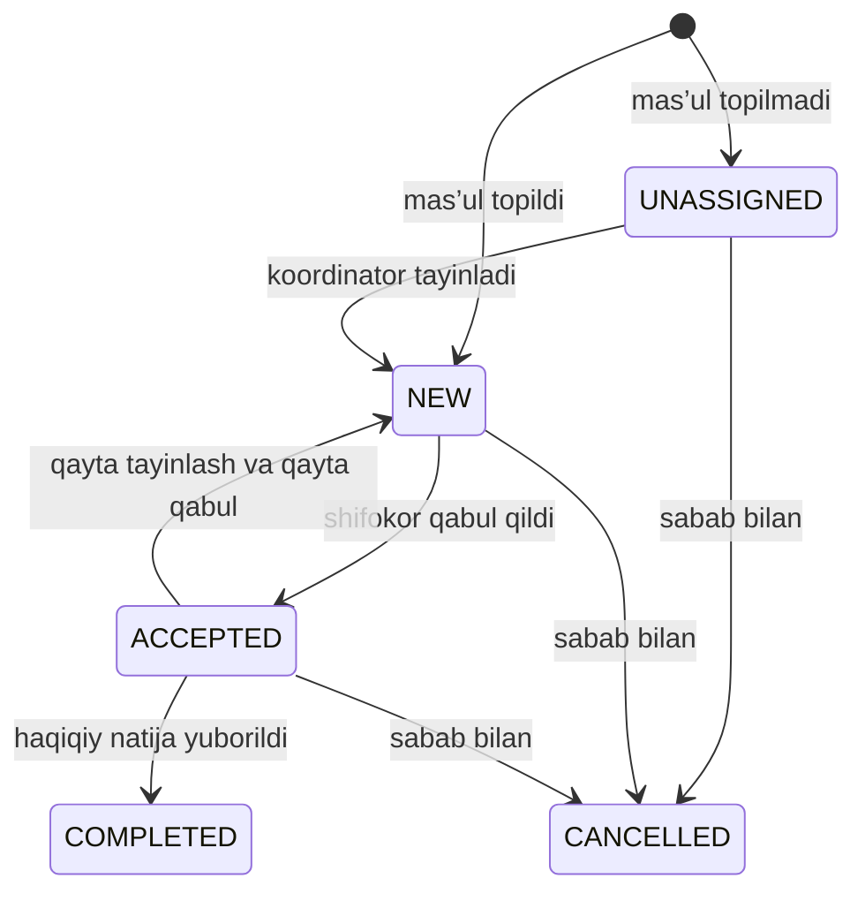
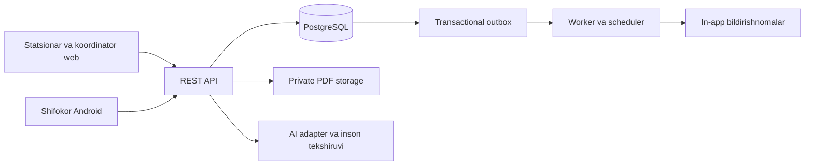

# MedicineTrack — texnik topshiriq

Versiya: 1.0 • Sana: 2026-11-17 • Holat: ishlab chiqish uchun bazaviy loyiha.

## 1. Hujjat asosi va chegaralari

Manba: `toshkent_dolzarb_muammolar (1).pdf`, 1-bet, 11-muammo, Umummilliy AI Xakaton (17–19 noyabr 2026).

**Manbadagi talab:** og‘ir bemor statsionardan (OvaBMU) chiqarilganda hududiy oilaviy shifokorga avtomatik “Aktiv chaqiruv” topshirig‘i yuboriladi; shifokor 24 soat ichida bemor holidan xabar olib, tizimda tasdiqlaydi.

Ushbu TZdagi arxitektura, AI, eslatmalar, rollar va sinov mezonlari jamoa uchun taklif etilgan yechimdir. 24 soat — topshiriq talabi; huquqiy norma sifatida ko‘rsatilmaydi. OvaBMU atamasi manbadagidek saqlandi; to‘liq rasmiy nomi PM tomonidan aniqlanadi. Reponing boshlang‘ich holatida faqat README va .gitignore mavjud: quyidagi imkoniyatlar hali implementatsiya qilingan deb hisoblanmaydi.

## 2. Maqsad va foydalanuvchi qiymati

MedicineTrack statsionar va oilaviy shifokor o‘rtasidagi bemor topshirish jarayonini kuzatiladigan vazifaga aylantiradi. Har bir chiqarish uchun mas’ul, o‘zgarmas muddat, aloqa tarixi va bajarilganlik dalili bo‘ladi. Koordinator mas’ulsiz yoki kechikkan bemorlarni alohida ko‘radi.

MVP muvaffaqiyati: demo bemorini chiqarishdan shifokor tasdig‘igacha bo‘lgan jarayon web va Android orqali bir xil backendda ishlaydi; 24 soat nazorati va kirish cheklovlari sinovdan o‘tadi. Qayta yotqizish yoki o‘limni kamaytirish kabi klinik natijalar prototip bilan isbotlangan deb ko‘rsatilmaydi.

## 3. Jamoa va javobgarlik

| Yo‘nalish | Mas’ul | Topshiriladigan natija |
|---|---|---|
| PM | @robiya777 | Scope, backlog, klinik jarayon savollari, demo, qabul tekshiruvi |
| Frontend web | @nuraziz07 | Statsionar va koordinator kabineti, responsive UI, API integratsiyasi |
| Android / APK | @akashishunichiro (foydalanuvchi) | Shifokor ilovasi, chaqiruvlar, natijani yuborish, o‘rnatiladigan APK |
| Backend | @sunnatila | API, DB, autentifikatsiya, SLA, bildirishnoma, AI adapter, deploy |

Handlelar foydalanuvchi bergan yozilishda kiritildi; GitHub akkauntlari yoki repo ruxsatlari tasdiqlangani anglatilmaydi. Backend API kontraktini yuritadi, frontend va APK iste’molchi talablarini bildiradi, PM o‘zgarishlarni ustuvorlashtiradi. Klinika tomonidan vakolatli mutaxassis mahsulot jamoasidan alohida tayinlanishi kerak.

## 4. MVP va keyingi bosqich

### P0 — majburiy

- Rollar bilan kirish; muassasa va bemor darajasida ruxsat.
- Bemor va tasdiqlangan chiqarish yozuvi.
- Bitta chiqarishga bitta avtomatik chaqiruv; shifokorga deterministik biriktirish.
- Mas’ul topilmasa koordinator navbati va uzluksiz 24 soat hisoblagichi.
- Shifokorning qabul qilishi, aloqa urinishlari, bajarish natijasi.
- Muddatdan oldin eslatma va muddatdan keyin eskalatsiya.
- Web monitoring va Android shifokor oqimi.
- Audit, demo dataset, API hujjati, ishga tushirish yo‘riqnomasi.

### P1 — xakatondagi AI moduli

Matnli PDF epikrizdan manbasi ko‘rsatilgan maydonlar va qisqa xulosa loyihasini ajratish, inson tasdig‘i bilan saqlash. P0 ishini bloklamaydi, lekin AI xakaton demosiga kiritiladi.

### Keyingi bosqich

Davlat tibbiy tizimlari, haqiqiy SMS/push provayderi, skan PDF uchun OCR, to‘liq offline sinxronizatsiya, bemor kabineti, elektron imzo va ko‘p tillilik. MVPda davlat bazalariga mavjud bo‘lmagan ulanish va’da qilinmaydi. Dori tayinlash, tashxis qo‘yish va tez yordam dispetcherligi scopega kirmaydi.

## 5. Rollar va kirish matritsasi

| Amal | Statsionar xodimi | Oilaviy shifokor | Koordinator | Texnik admin |
|---|---|---|---|---|
| Bemor/chiqarish loyihasini kiritish | O‘z muassasasida | Yo‘q | Yo‘q | Yo‘q |
| Chiqarishni tasdiqlash | Vakolatli xodim | Yo‘q | Yo‘q | Yo‘q |
| Bemor kartasini ko‘rish | O‘zi yaratgan chiqarish doirasida | Aktiv biriktirilgan vazifada | O‘z xizmat hududida | Standart holatda yo‘q |
| Qabul qilish va natija | Yo‘q | O‘z vazifasida | Yo‘q | Yo‘q |
| Qayta biriktirish/bekor qilish | Yo‘q | Yo‘q | O‘z hududida, sabab bilan | Yo‘q |
| Hisobot | O‘z chiqargan yozuvlari | O‘z vazifalari | O‘z hududi | Faqat texnik metrikalar |
| Akkaunt/ma’lumotnoma | Yo‘q | Yo‘q | Yo‘q | Ha |

UI yashirish yetarli emas: barcha tekshiruv backendda bajariladi. Topshiriq yopilgach shifokorda shu topshiriq tarixi qoladi; qayta biriktirilganda oldingi shifokor bemorning yangilanayotgan kartasini ko‘rmaydi. Texnik admin uchun klinik ma’lumotga alohida, audit qilinadigan ruxsat keyinchalik loyihalanadi.

## 6. Asosiy ssenariylar

### UC-01. Bemorni chiqarish

1. Statsionar xodimi bemorni mavjud ichki ID bo‘yicha tanlaydi yoki yaratadi.
2. Manzil, telefon, xizmat hududi, chiqarish vaqti va tavsiyalarni kiritadi.
3. Epikrizni biriktirishi va AI ajratgan maydonlarni tekshirishi mumkin.
4. Tasdiqlashdan oldin majburiy maydonlar va vaqt ko‘rsatiladi.
5. Bitta DB tranzaksiyada chiqarish tasdiqlanadi, chaqiruv va outbox hodisasi yaratiladi.
6. Xodim topshiriq IDsi, mas’ul va deadline’ni ko‘radi.

### UC-02. Biriktirish

Bemorning faol biriktirilishi → faol oilaviy shifokor va tegishli muassasa tekshiruvi → tayinlash. Topilmasa tizim tasodifiy shifokor tanlamaydi: `UNASSIGNED` navbatini yaratib koordinatorni ogohlantiradi. Koordinator faol shifokorni tanlaydi va sabab yozadi. Muddat o‘zgarmaydi.

### UC-03. Shifokor bajarishi

Shifokor APK yoki webda vazifani ochadi, qabul qiladi, bemor bilan bog‘lanadi/tashrif buyuradi. Aloqa urinishlarini qayd etadi. Majburiy natija formasi to‘ldirilgach server bajarishni tasdiqlaydi. “O‘qidim” yoki “Qabul qildim” bajarilganlik hisoblanmaydi.

### UC-04. Bemor bilan bog‘lanib bo‘lmasligi

Telefon javobsiz, noto‘g‘ri raqam, manzil topilmadi yoki rad etish alohida `ContactAttempt` bo‘ladi. Vazifa ochiq qoladi. Keyingi harakat va izoh kiritiladi; koordinatorga yordam so‘rovi yuborish mumkin. Bunday sabablar 24 soatni uzaytirmaydi.

### UC-05. Xato yozuv va qayta yotqizish

Tasdiqlanmagan loyiha tahrirlanadi. Tasdiqlangan chiqarish va natija jim o‘zgartirilmaydi: tuzatish sababi, eski/yangi qiymatlar auditda saqlanadi. Noto‘g‘ri chiqarishni koordinator sabab bilan bekor qiladi. Qayta yotqizish mavjud vazifani avtomatik “bajarildi” qilmaydi; koordinator uni tegishli sabab bilan bekor qiladi. Keyingi chiqarish alohida yangi hodisa va yangi chaqiruvdir.

### Vakolat va tahrir bo‘yicha aniqlashtirishlar

- Xodimning hududiy vakolati `User.organization_id → Organization.territory_id` orqali olinadi. Vazifa qabul qiluvchi tashkiloti bemorning xizmat hududiga biriktirilgan faol poliklinika orqali aniqlanadi. Tashkilot ham topilmasa `receiving_org_id=null` bo‘ladi va vazifa chiqaruvchi shifoxona koordinatorining istisnolar navbatida qoladi. Bu navbatga faqat shu shifoxona koordinatori kira oladi.
- Hududlararo transfer MVPga kirmaydi: vazifa chiqaruvchi koordinator nazoratida qoladi, PM vakolatli qabul qiluvchini aniqlaydi. MVP koordinatoriga boshqa hudud bemorlarini ko‘rish yoki o‘zicha boshqa hududga o‘tkazish huquqi berilmaydi.
- Mavjud bemorni qidirish faqat shu shifoxona ilgari yaratgan kartalar doirasida, aniq ichki UUID orqali amalga oshiriladi; global ism/telefon qidiruvi yo‘q. Topilmasa yangi karta yaratiladi; muassasalararo bemorlarni birlashtirish MVPdan tashqarida. Patientga `created_by_org_id` qo‘shiladi.
- Patient PATCH faqat yaratgan statsionar xodimiga va hali tasdiqlanmagan chiqarish doirasida kontakt/manzil kabi maydonlar uchun ruxsatli. Tasdiqlash paytida F.I.Sh., kontakt, manzil va klinik tavsiyalar discharge ichidagi snapshotga yoziladi; keyingi karta o‘zgarishi tarixiy taskni o‘zgartirmaydi. Shifokor aloqa tuzatishini ContactAttempt izohida bildiradi.
- Tasdiqlangan yozuvni tuzatish append-only: statsionar xodimi o‘z discharge tavsiyasiga, biriktirilgan shifokor o‘z VisitReport matniga correction qo‘shadi. Original o‘zgarmaydi. Discharged_at, performed_at, completed_at, due_at va task status correction bilan o‘zgarmaydi. Noto‘g‘ri chiqarish vaqti bo‘lsa koordinator bekor qiladi, statsionar bog‘langan yangi chiqarish yaratadi; bekor qilish alohida hisobotda qoladi.

## 7. Holatlar va vaqt qoidalari

- `overdue` mustaqil flag: ochiq vazifada `server_now > due_at`; alohida workflow holati emas.
- `due_at = discharged_at + 24 soat`. `discharged_at` — statsionardan haqiqiy chiqarilgan vaqt, `confirmed_at` — tizim tasdig‘i vaqti; ular alohida saqlanadi.
- Kelajakdagi chiqarish vaqtini tasdiqlash mumkin emas. Kech kiritilgan chiqarish uchun dastlabki muddat saqlanadi; muddat allaqachon o‘tgan bo‘lsa darhol eskalatsiya qilinadi.
- Vaqt UTCda saqlanadi, UI `Asia/Tashkent`da ko‘rsatadi. Dam olish kuni muddatni to‘xtatmaydi.
- Eslatmalar: chiqarilgandan 12 va 20 soat keyin, vazifa hali ochiq bo‘lsa. O‘tib ketgan eslatmalar kech importda birdaniga yuborilmaydi; faqat dolzarb ogohlantirish yuboriladi.
- 24 soat o‘tganda koordinatorga bitta eskalatsiya hodisasi yaratiladi; dashboard kechikishni davomiy ko‘rsatadi.
- Qayta tayinlash faqat ochiq task uchun: yangi shifokor tanlanganda status NEW, accepted_at=null; avvalgi qabul hodisasi auditda qoladi. Yangi shifokor qayta qabul qilishi shart. Terminal task qayta tayinlanmaydi.
- Qayta tayinlash, servis restarti, bildirishnoma xatosi muddatni yangilamaydi.
- Tashrif vaqti `discharged_at <= performed_at <= server_now`; yakunlash uchun `ACCEPTED` talab qilinadi.
- O‘z vaqtida bajarilganlik serverdagi `completed_at <= due_at` bo‘yicha hisoblanadi. Kech kiritilgan, lekin oldin bajarilgan tashrif alohida “kech hujjatlashtirilgan” sifatida ko‘rsatiladi; asosiy KPI orqaga sana yozish bilan yaxshilanmaydi.
- Yopilgan vazifa qayta ochilmaydi; tuzatish audit yozuvi bilan amalga oshiriladi.

## 8. Maydonlar va validatsiya

| Obyekt | Majburiy maydonlar | Qoidalar |
|---|---|---|
| Bemor | UUID, F.I.Sh., tug‘ilgan sana, manzil, hudud | Tug‘ilgan sana kelajakda emas; JSHSHIR MVPda talab qilinmaydi |
| Aloqa | kamida bitta telefon yoki “telefon yo‘q” sababi | Telefon bo‘lsa E.164; vakil telefoni alohida belgilanadi |
| Chiqarish | bemor, muassasa, discharged_at, shifokor tavsiyasi, kuzatuvga kiritish asosi | Og‘ir bemor ekanini klinik xodim belgilaydi; AI aniqlamaydi |
| Epikriz | fayl, yuklovchi, vaqt | Ixtiyoriy; PDF ≤10 MB, MIME va fayl signaturasi tekshiriladi |
| Chaqiruv | discharge_id, status, due_at, version | discharge_id UNIQUE; assignee UNASSIGNEDda null |
| Aloqa urinishi | task_id, vaqt, kanal, natija, muallif | O‘z vazifasi; discharged_at ≤ attempted_at ≤ server_now; recorded_at serverda, kech qayd alohida |
| Bajarish | performed_at, kanal, kuzatuv, bajarilgan ish, keyingi reja | “Kuzatuv talab qilinmaydi” bo‘lsa ham asos yoziladi |
| Bekor qilish | sabab kodi, izoh, muallif, vaqt | Koordinator vakolati; o‘chirish emas |

MVPda telefon orqali aloqa ham, uyga tashrif ham demo uchun yakunlash kanali bo‘lishi mumkin; real pilotdan oldin klinik hamkor qaysi holatda qaysi kanal yetarliligini tasdiqlaydi. Bu qaror mahsulot sozlamasi orqali boshqarilishi kerak.

## 9. AI modulining aniq kontrakti

Kirish: faqat vakolatli foydalanuvchi yuklagan matnli PDF yoki epikriz matni. Skan yoki o‘qilmaydigan faylga “Matn topilmadi, qo‘lda kiriting” qaytariladi. Hujjat ichidagi buyruqlar ma’lumot hisoblanadi, tizim ko‘rsatmasi sifatida bajarilmaydi.

Chiqish JSON: `summary`, `diagnosis_text`, `recommendations[]`, `follow_up_text`, `evidence[]` (maydon, sahifa, manba parchasi), `missing_fields[]`, `warnings[]`. Har bir chiqarilgan klinik fakt hujjat parchasiga bog‘lanadi. Topilmagan qiymat `null`; taxminiy dori, doza, sana yoki tashxis qo‘shilmaydi.

Natija `PENDING_REVIEW` holatida ko‘rsatiladi; xodim har bir maydonni qabul qiladi/tuzatadi, keyin saqlaydi. Manba va AI loyihasi saqlangan klinik yozuvdan ajratiladi. AI bemor identifikatori, shifokor yoki SLAni mustaqil o‘zgartira olmaydi. Model nomi/versiyasi, ishlov vaqti va tekshiruvchi audit qilinadi; raw tibbiy matn oddiy logga yozilmaydi.

Timeout 30 soniya, bitta nazoratli qayta urinish; xatoda qo‘lda kiritish mavjud. Mock AI javobi ishlatilsa UI “Demo/mock” deb ko‘rsatadi. Xakatonda sintetik ma’lumot ishlatiladi. Real ma’lumotning tashqi AIga uzatilishi alohida kelishilmaguncha o‘chiriladi.

## 10. Ekranlar va UX

### Web — @nuraziz07

- Login: xato, loading, sessiya tugashi holatlari.
- Statsionar dashboard: loyihalar, chiqarilganlar, bemor qidiruvi.
- Chiqarish formasi: maydonlar, PDF yuklash, AI review, tasdiqlash xulosasi.
- Chaqiruv tafsiloti: deadline, mas’ul, aloqa, tavsiyalar, timeline.
- Koordinator paneli: UNASSIGNED, deadline yaqin, overdue, muassasa/shifokor filtrlari.
- Qayta tayinlash va bekor qilish: sabab majburiy modal.
- Shifokor uchun web zaxira oqimi: ro‘yxat, accept, natija.

### Android APK — @akashishunichiro

- Login va xavfsiz sessiya saqlash.
- “Mening chaqiruvlarim”: ochiq, kechikkan, bajarilgan; pagination va refresh.
- Bemor/chaqiruv tafsiloti, telefon terish oynasini ochish, manzilni ko‘rish.
- Qabul qilish, aloqa urinishini qo‘shish, natijani yuborish.
- Tarmoq uzilganda tushunarli holat; qayta yuklash va yuborilmagan forma holatini ekranda saqlash.
- MVPda klinik ma’lumotni doimiy offline keshga yozish talab qilinmaydi. Server javobisiz “Bajarildi” ko‘rsatilmaydi.
- In-app bildirishnomalar foregroundda yangilanadi; background push keyingi integratsiya, mavjudligi va’da qilinmaydi.

UI o‘zbek lotin yozuvida; 360 px mobil va 1280 px desktopda foydalanish mumkin. Rangga qo‘shimcha matn/ikon bilan holat ko‘rsatiladi; form label va klaviatura navigatsiyasi bo‘ladi. Bo‘sh ro‘yxat, 403, 404, 409, 429 va server xatolari uchun alohida xabarlar kerak.

## 11. Arxitektura va texnologiyalar

Taklif: React + TypeScript web; Kotlin + Jetpack Compose Android; Django REST Framework backend; PostgreSQL; Celery + Redis; private fayl storage; Docker Compose. Bu tanlov implementatsiya mavjudligini anglatmaydi. Texnologiya almashsa API va biznes qoidalari saqlanadi, ADRda sabab yoziladi.

Tavsiya etilgan repo tuzilishi: `backend/`, `frontend/`, `android/`, `infra/`, `docs/`. Sirlar `.env` orqali, repoda faqat `.env.example`. API bir xil bo‘ladi; web va APK alohida biznes qoidalari yaratmaydi.

## 12. Ma’lumotlar modeli

| Jadval | Muhim ustunlar va bog‘lanish |
|---|---|
| Organization | id, name, type, territory_id, active |
| Territory | id, name, parent_id |
| User | id, username, role, organization_id, active |
| Patient | id, created_by_org_id, full_name, birth_date, address, territory_id, contact, no_phone_reason |
| PatientAssignment | patient_id, doctor_id, organization_id, valid_from, valid_to; bitta faol biriktirish |
| Discharge | id, patient_id, hospital_id, created_by, discharged_at, confirmed_at, recommendations, status, source_event_id |
| Attachment | discharge_id, private_storage_key, checksum, MIME, size, uploaded_by |
| CareTask | id, discharge_id UNIQUE, assigned_doctor_id nullable, receiving_org_id, status, due_at, accepted_at, completed_at, version |
| AssignmentHistory | task_id, old/new doctor, reason, actor_id, timestamp |
| ContactAttempt | task_id, channel, result, attempted_at, note, actor_id |
| VisitReport | task_id UNIQUE, performed_at, channel, observation, actions, follow_up, author_id |
| Notification/Outbox | task_id, event_type, recipient_id, dedupe_key UNIQUE, delivery_status, attempts, next_attempt_at |
| AIExtraction | discharge_id, status, structured_result, model_version, reviewed_by, reviewed_at |
| RecordCorrection | discharge_id yoki report_id, originalga havola, field, correction_text, reason, actor_id, created_at; append-only |
| AuditEvent | actor_id, entity_type/id, action, changed_fields, timestamp, request_id |

UUID tashqi identifikator; (status, due_at), assigned_doctor_id va receiving_org_id bo‘yicha indekslar. Confirmed chiqarishlar va klinik natijalar cascade delete bilan yo‘q qilinmaydi. Retention muddati real pilot oldidan belgilanadi; sintetik demo dataset alohida reset buyrug‘i bilan tozalanadi.

## 13. API kontrakti — /api/v1

JSON, UTF-8, UUID va ISO-8601 vaqt. JWT access token 15 daqiqa, refresh 7 kun — boshlang‘ich sozlama; logout refreshni bekor qiladi, inactive user darhol bloklanadi. Refresh rotatsiyasi va reuse nazorati kerak. Webda refresh HttpOnly Secure cookie, CSRF himoyasi; Androidda Keystore bilan himoyalangan saqlash. Access token log/URLga yozilmaydi.

| Metod va yo‘l | Vazifa / ruxsat |
|---|---|
| POST /auth/login, /auth/refresh, /auth/logout | Sessiya |
| GET /me | Joriy rol va muassasa |
| GET/POST /patients | Ruxsat doirasidagi qidiruv / statsionar yaratishi |
| GET/PATCH /patients/{id} | Ruxsatli ko‘rish / auditli tahrir |
| POST /discharges | DRAFT yaratish |
| PATCH /discharges/{id} | Faqat DRAFTni tahrirlash |
| POST /discharges/{id}/attachments | PDF upload |
| POST /discharges/{id}/ai-extractions | Asinxron ajratish, 202 |
| GET /ai-extractions/{id} | Jarayon holati/natija |
| POST /ai-extractions/{id}/review | Inson tekshiruvi natijasi |
| POST /discharges/{id}/confirm | Tranzaksion tasdiq va task; 201 yoki qayta so‘rovga mavjud natija |
| GET /tasks | Rol bo‘yicha filtrlangan pagination |
| GET /tasks/{id} | Tafsilot va timeline |
| POST /tasks/{id}/accept | Faqat biriktirilgan shifokor |
| POST /tasks/{id}/contact-attempts | Aloqa urinishi |
| POST /tasks/{id}/complete | VisitReport va terminal holatni atomik yozish |
| POST /tasks/{id}/reassign | Koordinator, sabab bilan |
| POST /discharges/{id}/corrections | Vakolatli statsionar xodimi, faqat izoh/tavsiya tuzatishi |
| POST /tasks/{id}/report-corrections | Hisobot muallifi, faqat matn tuzatishi; vaqt/status o‘zgarmaydi |
| POST /tasks/{id}/cancel | Koordinator, sabab bilan |
| GET /dashboard/metrics | Koordinatorning hududiy metrikalari |
| GET /notifications | O‘z bildirishnomalari |
| POST /notifications/{id}/read | O‘qilganini belgilash |
| GET /reference/organizations, /territories, /doctors | Vakolat doirasidagi ma’lumotnoma |

List: `results`, `count`, `next`, `previous`; page_size 20, maksimum 100. Filtrlar: status, overdue, due_before, doctor_id, organization_id, discharged_from/to. Ruxsat doirasi filtrdan oldin qo‘llanadi.

Xato shakli: `{"code":"VALIDATION_ERROR","message":"Maydonlarni tekshiring","fields":{"performed_at":["Kelajakdagi vaqt mumkin emas"]},"request_id":"uuid"}`. 400 validatsiya, 401 sessiya, 403 vakolat, 404 mavjud emas/yashirilgan obyekt, 409 holat yoki versiya konflikti, 413 fayl hajmi, 429 limit, 503 tashqi servis.

Mutatsiyalar `Idempotency-Key` qabul qiladi: bir user + endpoint + key uchun 24 soat natija saqlanadi; bir key bilan boshqa payload 409. Discharge/task unique cheklovi bu muddatdan keyin ham dublikatni oldini oladi. `version` optimistik bloklash uchun yuboriladi; eskirgan versiya 409 qaytaradi. Biriktirish va complete parallel kelsa row lock va versiya bilan faqat bittasi amal qiladi. API OpenAPI fayli backend implementatsiyasi bilan birga yuritiladi.

## 14. Bildirishnoma va fon ishlarining kafolatlari

Scheduler har 60 soniyada ochiq vazifalarni tekshiradi. Confirm tranzaksiyasi outbox yozuvini ham saqlaydi; worker restartidan keyin hodisa yo‘qolmaydi. Yetkazish kamida bir marta, foydalanuvchidagi yozuv esa dedupe_key bilan bitta bo‘ladi. Kalit: task_id + event_type + recipient_id. Retry: 1, 5, 15 daqiqa, keyin FAILED va texnik panel; task hech qachon o‘chmaydi. Yakunlash/bekor qilishdan keyin yuborish oldidan holat qayta tekshiriladi. Xato qayta urinishlar klinik deadline’ni o‘zgartirmaydi.

MVPning kafolatlangan kanali — in-app. Kelajakdagi SMS/Telegram matnida faqat task ID va autentifikatsiya talab qiladigan havola; tashxis, F.I.Sh., epikriz yoki telefon yozilmaydi. Push yetkazilganligi bemor ko‘rilganligi hisoblanmaydi.

## 15. Xavfsizlik va operatsion talablar

- Public GitHubga faqat kod, hujjat va sintetik dataset; haqiqiy bemorlar, credentiallar, tokenlar va real epikrizlar kiritilmaydi.
- HTTPS, qat’iy CORS allowlist, login rate limit: IP bo‘yicha 10 urinish/daqiqa; umumiy sozlamalar konfiguratsiyada.
- Fayllar private; yuklab olish har safar obyekt ruxsati bilan tekshiriladi. Fayl nomi yo‘l sifatida ishlatilmaydi.
- Audit klinik matnni keraksiz nusxalamaydi; sezgir maydon o‘zgarishlari cheklangan kirishli audit storage’da saqlanadi.
- Loglar: request_id, endpoint, status, latency; bemor matni, token va fayl mazmuni chiqarilmaydi.
- `/health/live` jarayon, `/health/ready` DB va zarur xizmatlar holatini tekshiradi; public javob ichki sirlarni ochmaydi.
- Server nazoratidagi vaqt manbasi; deadline klient soatiga bog‘liq emas.
- Real pilot uchun backup: har 24 soat, RPO ≤24 soat, RTO ≤4 soat maqsadi; restore amaliy tekshiruvsiz bajarilgan deb belgilanmaydi.
- Real bemor ma’lumotlari bilan pilotdan oldin vakolat, rozilik asosi, hosting/saqlash joyi, retention, insident javobi va AIga uzatish tartibi tegishli mutaxassislar bilan tasdiqlanadi. Ushbu hujjat huquqiy muvofiqlik sertifikati emas.

## 16. O‘lchanadigan sifat talablari

Qabul muhiti: 2 vCPU, 4 GB RAM, 1 000 sintetik bemor, 1 000 task, 20 parallel foydalanuvchi; frontend/API bir regionda. Qurilma va tarmoq sharoiti sinov hisobotida qayd etiladi.

- AI/uploaddan tashqari read API p95 ≤1 soniya, write p95 ≤2 soniya, 5 daqiqalik yuklamada server xatosi <1%.
- Tasdiqlangan chiqarish taski API javobida mavjud; in-app bildirishnoma sog‘lom workerda ≤10 soniya.
- Overdue eskalatsiyasi sog‘lom schedulerda deadline’dan ≤60 soniya keyin.
- 360 px ekranda asosiy tugmalar kesilmaydi, forma gorizontal scroll talab qilmaydi.
- Android minimum API 26 — taklif; target SDK build vaqtida qo‘llab-quvvatlanadigan toolchainga mos belgilanadi. Kamida bitta fizik Android qurilmada install/login/complete tekshiriladi; faqat emulator bilan real qurilma ishonchliligi tasdiqlanmaydi.
- Demo uchun barcha P0 qabul sinovlari o‘tadi; production uptime SLA alohida shartnoma predmeti.

## 17. Hisobotlar va KPI formulalari

Davr task yaratilgan vaqt bo‘yicha olinadi; barcha ko‘rsatkichlar ruxsat hududiga cheklangan. Test yozuvlari va sabab bilan bekor qilinganlar alohida ko‘rsatiladi.

- Aktiv: UNASSIGNED + NEW + ACCEPTED.
- Overdue aktiv: aktiv va now > due_at.
- Mas’ulsiz: UNASSIGNED.
- O‘z vaqtida bajarilgan: COMPLETED va completed_at ≤ due_at.
- SLA uchun baholanadiganlar: bekor qilinmagan, deadline’i o‘tgan YOKI oldin yakunlangan tasklar. Hali muddati kelmagan ochiq tasklar maxrajga kirmaydi.
- SLA foizi: o‘z vaqtida bajarilgan / baholanadiganlar ×100; maxraj 0 bo‘lsa “Ma’lumot yo‘q”.
- Birinchi aloqa vaqti: birinchi ContactAttempt.attempted_at − discharged_at; qabul qilish vaqti aloqa o‘rnida olinmaydi.
- Aloqa yo‘qligi, kech hujjatlashtirish va bekor qilish sonlari alohida ko‘rsatiladi.

## 18. Qabul sinovlari

| ID | Ssenariy | Kutiladigan natija | Yetakchi |
|---|---|---|---|
| AT-01 | To‘liq chiqarish tasdiqlanadi | Bitta task, to‘g‘ri mas’ul va due_at | Backend |
| AT-02 | Ikki parallel confirm | Bitta task va bitta yaratilish bildirishnomasi | Backend |
| AT-03 | Biriktirish yo‘q | UNASSIGNED, koordinatorga chiqadi, deadline saqlanadi | Backend |
| AT-04 | Shifokor inactive | Tayinlanmaydi, koordinator navbatiga tushadi | Backend |
| AT-05 | Discharged_at 25 soat oldin | Darhol overdue, eski eslatmalar to‘planmaydi | Backend |
| AT-06 | Faqat qabul qilindi | Task ACCEPTED, KPIda bajarildi emas | APK/Web |
| AT-07 | Javobsiz qo‘ng‘iroq | Urinish saqlanadi, task ochiq | APK |
| AT-08 | To‘liq natija yuborildi | VisitReport va COMPLETED atomik | Backend/APK |
| AT-09 | Bo‘sh yoki kelajakdagi natija | 400; task ochiq | Backend |
| AT-10 | Deadline o‘tdi | ≤60 soniyada koordinatorga bitta eskalatsiya | Backend |
| AT-11 | Qayta tayinlash | Tarix bor, deadline o‘zgarmaydi, eski kirish bekor | Backend/Web |
| AT-12 | Boshqa muassasa IDsi taxmin qilinadi | API ma’lumot bermaydi; ro‘yxat/metrics/fayl ham himoyalangan | Backend |
| AT-13 | Worker to‘xtab qayta ishga tushdi | Outbox tiklanadi, dublikat bildirishnoma yo‘q | Backend |
| AT-14 | Complete javobi yo‘lda yo‘qoldi, qayta yuborildi | Bitta report, barqaror idempotent javob | Backend/APK |
| AT-15 | Bir vaqtning o‘zida reassign va complete | Bitta amal; ikkinchisiga 409 yoki vakolat xatosi | Backend |
| AT-16 | AI mavjud bo‘lmagan maydon | null/Topilmadi, to‘qima qiymat yo‘q | Backend/Web |
| AT-17 | AI timeout yoki skan PDF | Tushunarli xato; qo‘lda chiqarish ishlaydi | Web |
| AT-18 | PDF ichida buyruq bor | Buyruq bajarilmaydi, faqat ma’lumot sifatida o‘qiladi | Backend |
| AT-19 | Android tarmoq uzildi | Soxta muvaffaqiyat yo‘q, qayta urinish mavjud | APK |
| AT-20 | 360 px va fizik qurilma | Asosiy oqim ishlaydi, tugmalar ko‘rinadi | Web/APK |
| AT-21 | 10 MBdan katta yoki soxta PDF | 413/400; private storagega zararli fayl qabul qilinmaydi | Backend |
| AT-22 | JWT logout/refresh reuse | Sessiya qayta ishlatilmaydi; inactive user bloklanadi | Backend |
| AT-23 | KPIda hali muddati kelmagan task | Maxrajga kirmaydi; 0 maxraj to‘g‘ri ko‘rsatiladi | Backend/Web |

Testlarda soat boshqariladi; production soati o‘zgartirilmaydi. Demo vaqtini tezlatish faqat alohida demo rejimida, ekranda belgi va alohida konfiguratsiya bilan mumkin.

## 19. Ish rejasi va integratsiya nuqtalari

| Bosqich | Backend @sunnatila | Web @nuraziz07 | APK @akashishunichiro | PM @robiya777 |
|---|---|---|---|---|
| 1-kun | Schema, auth, seed, confirm/task API, OpenAPI | Login, chiqarish formasi, mock kontrakt | App skeleti, login, task list | Scope, ssenariy, klinik savollar |
| 2-kun | Accept/complete, SLA, outbox, RBAC | Koordinator, tafsilot, API integratsiya | Accept, aloqa, complete integratsiya | Oraliq qabul, bloklovchilar |
| 3-kun | AI adapter, audit, deploy va test | AI review, responsive va xato holatlari | Fizik qurilma QA, APK build | To‘liq demo, dalillar, taqdimot |

Birinchi integratsiyagacha backend login, task response, error schema va seed akkauntlarni beradi. API o‘zgarishlari bir kunlik integratsiyani sindirmasligi uchun kontrakt va ikki klient birgalikda yangilanadi. P0 tugamasdan qo‘shimcha funksiyalar kengaytirilmaydi.

## 20. Definition of Done va topshiriladigan fayllar

- Ishlaydigan backend, web va install qilinadigan APK; versiya va commit SHA qayd etilgan.
- DB migrations, sintetik seed, `.env.example`, Docker Compose va toza muhitdan ishga tushirish yo‘riqnomasi.
- OpenAPI kontrakti, rol matritsasi va AT-01…AT-23 natijalari; bajarilmagan testlar yashirilmaydi.
- Demo akkauntlar faqat demo muhit uchun; ommaviy production parollari repoda bo‘lmaydi.
- Android debug APK xakaton uchun yetarli; tarqatish turi aniq yoziladi. Release signing siri repoga kiritilmaydi.
- Klinik ma’lumotlar logda/repo tarixida yo‘qligi tekshirilgan; fizik qurilma natijasi qayd etilgan.
- Build o‘tishi deploy yoki klinik pilotga tayyorlik deb atalmasligi kerak; demo URL alohida smoke testdan o‘tadi.

## 21. Demo ssenariysi — 5 daqiqa

1. Statsionar webda sintetik bemor va epikriz ochiladi.
2. AI ajratgan tavsiya manbasi ko‘rsatiladi, xodim tasdiqlaydi.
3. Chiqarish tasdiqlanadi; task ID, mas’ul va 24 soat muddat chiqadi.
4. Androidda shu task ko‘rinadi, shifokor qabul qiladi va natija yozadi.
5. Koordinator panelida bajarilganlik va audit ko‘rsatiladi.
6. Oldindan tayyorlangan mas’ulsiz va kechikkan tasklar bilan istisno oqim namoyish qilinadi.

## 22. Risklar, taxminlar va pilot oldidan qarorlar

| Masala | MVP qarori / keyingi shart | Mas’ul |
|---|---|---|
| Shifokor biriktirish bazasi yo‘q | Sintetik ichki ma’lumotnoma; real manba pilotdan oldin | PM/Backend |
| Telefon tashrif o‘rniga yetarlimi | Demo uchun ikkisi; real holatlar klinik hamkor tasdig‘i bilan | PM |
| “Og‘ir bemor” mezoni | Vakolatli shifokor tanlaydi; AI risk balli yo‘q | PM |
| Xodim ta’tilda yoki ish vaqtidan tashqari | Koordinatorga qayta biriktirish; 24 soat o‘zgarmaydi | PM |
| Bemor boshqa hududga ketdi | MVPda transfer yo‘q; istisno qaydi va PM orqali vakolatli hamkorni aniqlash; deadline saqlanadi | PM/Backend |
| Internet/push yo‘q | Web zaxira, refresh, in-app; kafolatlanmagan pushga bog‘lanmaslik | APK/Backend |
| AI noto‘g‘ri ajratadi | Evidence va inson review; asosiy jarayon qo‘lda ishlaydi | Backend/Web |
| Real tibbiy ma’lumot va hosting | Alohida vakolat va ma’lumotlar rejimi tasdiqlanmaguncha faqat sintetik demo | PM |
| Muddat talabi va haqiqiy ish jarayoni | Pilotdan oldin hamkor muassasa bilan kelishish | PM |

Bu ochiq savollar MVP ishlab chiqishni to‘xtatmaydi; belgilangan demo qarorlari bilan davom etiladi. Real pilot qarorlari tasdiqlanmaguncha demo siyosati klinik amaliyot qoidasi sifatida qo‘llanmaydi.
